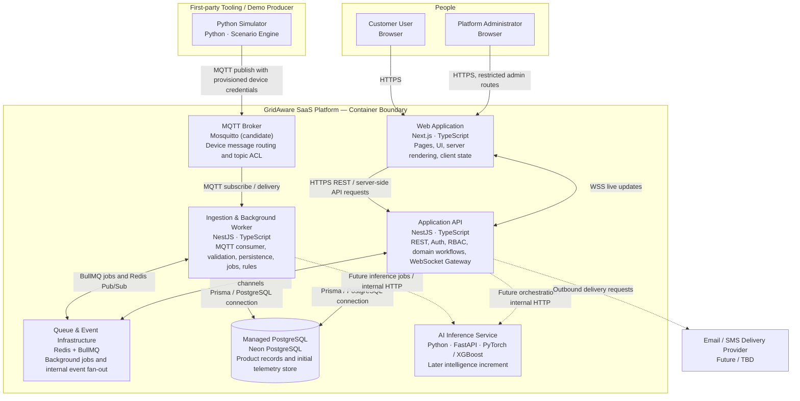

# GridAware — C4 Level 2: Container Architecture

**Document ID:** ARC-C4-002  
**Version:** 0.1  
**Status:** Proposed baseline for architecture review  
**C4 level:** 2 — Containers

---

## 1. Purpose

This document decomposes the GridAware SaaS platform into its primary runtime containers. A container in the C4 model is an independently running application or data store, not necessarily a Docker container. The implementation is expected to use Docker images for deployable services where practical.

The architecture is designed for a simulator-first MVP while preserving clear extension points for real telemetry producers and Python AI workloads later.

## 2. Architecture Summary

The recommended baseline is:

- **Next.js Web Application:** User-facing SaaS interface.
- **NestJS Application API:** Synchronous HTTP API, authentication, authorization, domain workflows, and WebSocket gateway.
- **NestJS Worker Runtime:** MQTT consumption, telemetry ingestion, background processing, and scheduled tasks. It is built from the same backend codebase as the API but deployed/run as a separate process so ingestion and long-running jobs do not compete directly with interactive API requests.
- **MQTT Broker:** Device/simulator message transport. Mosquitto is the initial candidate.
- **Redis:** BullMQ job queue infrastructure and lightweight event fan-out for real-time updates.
- **Neon PostgreSQL:** Source of truth for transactional product records and initial telemetry storage.
- **Python Simulator:** Synthetic telemetry producer. It is a first-party support tool outside the core SaaS API boundary; its hosting/tenant demo model remains open.
- **Python AI Service:** Later container for model inference. It is deliberately not required for the first end-to-end telemetry and rule-based alert workflow.

The API and Worker may share NestJS domain modules and Prisma client code. They must not duplicate business rules or create a second competing source of truth.

## 3. C4 Level 2 Diagram



> Diagram convention: solid arrows represent the initial/proposed runtime path. Dashed arrows represent optional or later integrations. The AI service and outbound provider are not dependencies for the initial telemetry persistence workflow.

## 4. Container Catalogue

### 4.1 Web Application

| Attribute | Definition |
|---|---|
| Name | GridAware Web Application |
| Technology | Next.js + React + TypeScript |
| Responsibility | Render the SaaS UI and provide user interactions |
| Interfaces | Browser HTTPS; HTTPS calls to NestJS API; WSS for live updates |
| State ownership | UI-only state and short-lived view state in the client; server-owned business data remains in the backend |
| Authentication | Uses the backend-approved auth/session mechanism; exact cookie/token design remains open |
| Must not | Connect directly to Neon, Redis, or MQTT; make authorization decisions only in the UI; contain server secrets in client bundles |

**Main capabilities:**

- Organization and site navigation.
- Role-aware dashboard and pages.
- Infrastructure/asset/sensor management interfaces.
- Live and historical telemetry views.
- Alert and incident workflows.
- Work-order and maintenance interfaces.
- Analytics and administration screens.
- Loading, empty, error, stale, offline, and permission-denied states.

**Primary communication:** HTTPS for API reads/writes and WebSocket Secure for authorized real-time events. Whether some server-rendered requests pass through a Next.js server-side data layer or call the API from the browser is an implementation detail to settle with the authentication/session decision. In either case, NestJS remains the system of record and authorization authority.

### 4.2 Application API

| Attribute | Definition |
|---|---|
| Name | GridAware Application API |
| Technology | NestJS + TypeScript |
| Runtime | Node.js process/container |
| Responsibility | Public API, user authentication, authorization, domain operations, orchestration, and real-time client gateway |
| Interfaces | HTTPS REST, WebSocket Secure, internal communication to data/queue services, later internal AI API |
| Data access | Prisma ORM to Neon PostgreSQL |
| Must not | Trust caller-supplied tenant IDs without membership validation; perform unbounded telemetry processing inside request handlers; let the AI service own product authorization |

**Domain responsibilities (high-level):**

- Identity and authentication.
- Organization and membership context.
- Role/permission checks.
- Sites, buildings, areas, and assets.
- Devices, sensors, and metric definitions.
- Telemetry query/read APIs.
- Alert, incident, and work-order workflows.
- Notification and audit records.
- Analytics query orchestration.
- WebSocket subscription authorization and event delivery.

The detailed NestJS module and component structure is a separate Phase 3.3 deliverable.

### 4.3 Ingestion & Background Worker

| Attribute | Definition |
|---|---|
| Name | GridAware Ingestion & Background Worker |
| Technology | NestJS + TypeScript, shared backend codebase |
| Runtime | One or more worker processes/containers |
| Responsibility | MQTT consumption, validation, deduplication, telemetry writes, queued processing, rule evaluation, aggregation, and asynchronous operations |
| Interfaces | MQTT subscription, Redis/BullMQ, Redis Pub/Sub, Prisma to Neon |
| Scaling | Can scale independently from the API runtime when throughput requires it |
| Must not | Depend on the browser being connected; lose accepted telemetry silently; create duplicate business effects on retry; block ingestion while waiting for AI inference |

**Worker roles may be separated operationally:**

1. **MQTT ingestion consumer:** Receives messages, validates identity/schema, and writes accepted telemetry.
2. **Outbox relay:** Publishes committed processing intents to BullMQ and records delivery state.
3. **Domain processing worker:** Evaluates rules, creates/updates alerts, creates notifications, and triggers downstream tasks.
4. **Scheduled worker:** Handles stale-sensor checks, retention/aggregation jobs, and scheduled maintenance reminders when implemented.

These are logical worker roles. They can initially run in one worker application with separate queues/concurrency settings. They should be split into separately deployed processes only when workload, reliability, or scaling justifies it.

### 4.4 MQTT Broker

| Attribute | Definition |
|---|---|
| Name | GridAware MQTT Broker |
| Candidate | Eclipse Mosquitto |
| Responsibility | Accept authenticated simulator/device publishes and route telemetry to authorized subscribers |
| Protocol | MQTT; use TLS for hosted/untrusted network paths |
| Security | Per-device credentials or certificates, topic ACLs, credential rotation, broker-level connection controls |
| Must not | Be exposed as an unrestricted public broker; treat topic names or payload fields alone as proof of device/tenant identity |

**Proposed topic pattern:**

```text
gridaware/{organizationKey}/{siteKey}/{deviceKey}/telemetry
```

The device identity authenticated by the broker and checked against the device registry is authoritative. The topic is an authorization/routing input, not the only source of truth.

### 4.5 Queue & Event Infrastructure

| Attribute | Definition |
|---|---|
| Name | GridAware Queue & Event Infrastructure |
| Technology | Redis + BullMQ (proposed) |
| Responsibility | Background job scheduling, retries, delayed jobs, and lightweight internal event fan-out |
| Consumers | NestJS workers; API may subscribe to real-time event channels |
| Reliability | Idempotent jobs, bounded retries, dead-letter/failure visibility, queue-lag monitoring |
| Must not | Be the source of truth for organizations, incidents, or telemetry records |

Redis is an execution/coordination component. Durable product state remains in PostgreSQL. A job payload should carry identifiers and versioned event context rather than becoming a second database.

### 4.6 Managed PostgreSQL Database

| Attribute | Definition |
|---|---|
| Name | GridAware Primary Database |
| Provider | Neon PostgreSQL |
| ORM/data-access | Prisma |
| Responsibility | System of record for tenants, users/memberships, infrastructure, sensor/device configuration, telemetry, alerts, incidents, work orders, notifications, and audit records |
| Initial telemetry approach | PostgreSQL table(s) with timestamp-oriented indexes and bounded queries |
| Must not | Assume a managed database extension is available without checking the actual Neon plan/compatibility; expose credentials to the browser; allow unbounded time-series queries |

**Initial data domains:**

- Tenant and identity records.
- Site/building/asset hierarchy.
- Device and sensor registry.
- Metric and threshold configuration.
- Telemetry events/measurements.
- Alerts and incidents.
- Work orders and maintenance records.
- Notifications and audit events.
- Outbox or job-dispatch records where needed for reliable asynchronous processing.

Prisma is used for typed access and schema migrations. The final table structure, partitioning, retention, and indexes are Phase 3.2 database design decisions.

### 4.7 Python Simulator

| Attribute | Definition |
|---|---|
| Name | GridAware Infrastructure Simulator |
| Technology | Python |
| Responsibility | Produce seeded, repeatable synthetic generator measurements and fault scenarios |
| Interfaces | MQTT publish using a provisioned simulator device identity; optional CLI/control interface |
| Scenarios | Normal operation, gradual overheating, abnormal vibration, cooling degradation, shutdown, sensor offline, duplicate, delayed, and out-of-order events |
| Deployment posture | Local/dev/staging initially; hosted demo runtime is an open decision |
| Must not | Present synthetic measurements as real field telemetry; self-assign tenant/asset authority through message payloads; send control commands to physical equipment |

The simulator is intentionally outside the core SaaS application container boundary in the context view because it acts as a telemetry producer. It is first-party tooling and may be packaged/deployed alongside the platform in a demo environment.

### 4.8 Python AI Inference Service — Later Increment

| Attribute | Definition |
|---|---|
| Name | GridAware AI Service |
| Technology | Python + FastAPI; PyTorch / scikit-learn / XGBoost as model needs require |
| Responsibility | Preprocessing and inference for evaluated anomaly/failure/forecast models |
| Interfaces | Internal authenticated API or queued request/response contract |
| Product authority | NestJS remains responsible for authorization, tenant context, business workflows, and persistence of product-facing predictions |
| MVP dependency | Not required for the first telemetry and threshold-based alert workflow |
| Must not | Access customer data without tenant-scoped orchestration; change asset state directly; silently convert model errors into low-risk/healthy values |

AI service failures should create observable failed/pending inference tasks and should not block telemetry persistence or deterministic rule-based monitoring.

### 4.9 External Notification Provider — Future

A provider for email or SMS has not been selected. In-app notifications should remain stored in GridAware and available through the web application. External delivery failure must not roll back an incident or work order.

## 5. Runtime and Deployment Relationships

The first deployment can use a small number of Dockerized runtimes:

- `web`: Next.js application.
- `api`: NestJS HTTP/WebSocket process.
- `worker`: NestJS worker process using the same application codebase.
- `mqtt`: Mosquitto broker for simulator messaging.
- `redis`: queue and event infrastructure.
- `simulator`: Python process for local/demo telemetry generation.
- Neon: managed PostgreSQL outside Docker.
- `ai-service`: omitted until the intelligence increment requires it.

This is a logical deployment map, not a commitment to a particular hosting vendor or production sizing. A managed Redis/MQTT service may replace self-hosted containers later.

## 6. Primary Runtime Flows

### 6.1 User request flow

1. User opens the Next.js application.
2. The web application sends an authenticated HTTPS request to the NestJS API.
3. NestJS resolves the user identity and validates the active organization membership.
4. The relevant domain service applies permission and tenant-scope checks.
5. Prisma reads or changes data in Neon PostgreSQL.
6. The API returns a bounded response.
7. If the operation creates an event for connected users, the API/worker publishes an internal event and the WebSocket gateway broadcasts it only to authorized subscribers.

### 6.2 Telemetry flow

1. The simulator generates a measurement event.
2. It publishes to the provisioned MQTT topic using its device credentials.
3. The MQTT broker authenticates the producer and applies topic permissions.
4. The worker consumes the message.
5. The worker validates the schema and resolves the device using trusted registration/configuration.
6. The worker validates metric names, units, timestamps, and quality fields.
7. A duplicate event is ignored safely; a valid event is persisted with server-assigned ingestion time.
8. A durable processing intent is recorded (for example through an outbox row) and relayed to BullMQ.
9. A processing worker evaluates configured thresholds/rules and creates/updates alert records where appropriate.
10. Internal events are published for real-time notification and authorized browser updates.

### 6.3 Future AI flow

1. A queued job requests inference for an eligible asset/time window.
2. NestJS supplies a validated, tenant-scoped feature payload to the internal Python AI service.
3. The AI service returns a versioned response with model identity, prediction time, result, confidence/calibration metadata where supported, and explanation metadata where available.
4. NestJS validates and persists the result as a product record.
5. The UI presents it as an estimate, not a guaranteed failure diagnosis.

## 7. API and Worker Separation

The API and worker are separate runtime roles, not separate bounded contexts or independently designed business applications.

**Why separate runtime roles:**

- HTTP latency should not be dominated by telemetry consumption or batch work.
- MQTT reconnection and queue concurrency need independent operational control.
- Worker processes can scale horizontally without scaling web/API processes.
- Jobs should continue when no user is connected.
- The same domain policies, DTOs/contracts, and Prisma access layer can be reused.

**Implementation constraint:** Do not create two independent implementations of alert/incident business rules. Put domain logic in shared NestJS modules/services and call it from HTTP or worker entry points.

## 8. Data Ownership and Access Rules

- Neon PostgreSQL is the durable source of truth.
- Next.js does not connect directly to Neon or Redis.
- The simulator does not write to Neon directly.
- The MQTT broker transports messages but does not own asset/tenant truth.
- The worker validates the device registry before accepting telemetry.
- The API owns user/tenant authorization and domain commands.
- Python AI owns model execution, not customer authorization or product record lifecycle.
- Redis jobs/events are transient execution messages; durable business records remain in PostgreSQL.

## 9. Failure Isolation

| Failure | Expected system behavior |
|---|---|
| Web application unavailable | Backend/ingestion may continue; users temporarily cannot interact through the UI |
| API unavailable | Telemetry ingestion can continue if worker/broker/database are healthy; user-facing requests fail with observable errors |
| MQTT broker unavailable | Simulator messages cannot be delivered; simulator should surface connection failure and retry according to policy |
| Worker unavailable | Broker may retain messages according to configured QoS/session/storage policy; backlog/recovery behavior must be tested; accepted messages must not be silently lost |
| Redis unavailable | Durable telemetry writes should continue if designed to commit a processing outbox; processing and real-time fan-out may be delayed |
| Neon unavailable | Telemetry cannot be durably accepted; worker should pause/retry and expose health degradation rather than acknowledge a successful durable write |
| AI service unavailable | Core telemetry, rules, alerts, and incidents continue; AI result remains pending/failed and can be retried |
| Notification provider unavailable | In-app incident state remains available; external delivery retries or fails visibly without losing the incident |

The exact MQTT QoS, broker persistence, outbox behavior, and retry policies are Phase 3.2/3.3 design items and must be tested before production.

## 10. Initial Capacity Assumptions

The PRD defines an initial benchmark target of 100 telemetry events/second. This is a starting test workload, not a production capacity guarantee.

The capacity test must define:

- Number of simulated devices.
- Events per device per second.
- Number of metric readings per event.
- Message payload size.
- MQTT QoS.
- Worker concurrency.
- Redis queue behavior.
- Database connection settings.
- Retention assumptions.
- Query mix and dashboard subscribers.

Scaling decisions should be based on measured bottlenecks, not on assumptions that the first version requires microservices or a specialized time-series database.

## 11. Technology and Responsibility Matrix

| Concern | Primary owner | Supporting technology |
|---|---|---|
| Browser UI | Web container | Next.js, React, TypeScript |
| Authentication and user permissions | NestJS API | NestJS guards/policies; exact auth/session mechanism TBD |
| Tenant and domain data | NestJS API | Prisma, Neon PostgreSQL |
| Telemetry transport | MQTT broker | Mosquitto candidate, MQTT |
| Telemetry ingestion | NestJS Worker | MQTT client, validation, Prisma |
| Background processing | NestJS Worker | Redis, BullMQ |
| Real-time UI events | NestJS API | WebSockets, Redis event fan-out if needed |
| Synthetic telemetry | Simulator | Python |
| Model inference | Python AI service (later) | FastAPI, PyTorch/ML libraries |
| Durable product state | Neon PostgreSQL | PostgreSQL, Prisma |
| Outbound email/SMS | Adapter/provider (later) | Provider TBD |

## 12. Container-Level Review Checklist

- [ ] Each container has one primary responsibility.
- [ ] API and worker are separate runtime roles from one shared backend codebase.
- [ ] Web application has no direct database or broker access.
- [ ] MQTT identity is checked against trusted device registration.
- [ ] Redis is not treated as the system of record.
- [ ] AI is not required for initial telemetry ingestion or rule evaluation.
- [ ] The simulator is clearly labeled as a producer of synthetic data.
- [ ] Failure behavior is defined for each dependency.
- [ ] The initial deployment can be run locally with a documented Compose topology.
- [ ] The selected Neon plan and Prisma runtime/migration connection model are verified during implementation setup.

## 13. Related Documents

- [System Context](./system-context.md)
- [C4 Level 1 — Context](./c4-context.md)
- [Data Flow Overview](./data-flow-overview.md)
- [Open Architecture Decisions](./open-architecture-decisions.md)
- [ADR-0001 — Modular Monolith](./architecture-decision-records/ADR-0001-modular-monolith.md)
- [ADR-0002 — Initial Data Store](./architecture-decision-records/ADR-0002-neon-postgresql-and-telemetry.md)
- [ADR-0003 — Python AI Boundary](./architecture-decision-records/ADR-0003-python-ai-service-boundary.md)
