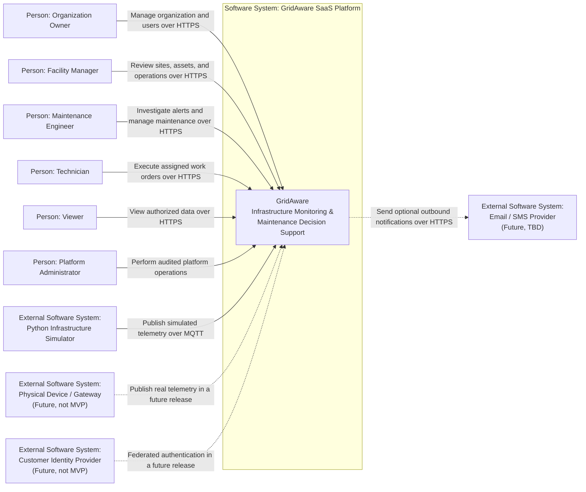

# GridAware — C4 Level 1: System Context Diagram

**Document ID:** ARC-C4-001  
**Version:** 0.1  
**Status:** Draft for architecture review  
**C4 level:** 1 — System Context

---

## 1. Diagram Objective

The C4 System Context diagram presents GridAware as one software system and shows the people and external software systems that interact with it. It intentionally hides internal containers such as Next.js, NestJS, MQTT, Redis, and Neon PostgreSQL. Those are described in the C4 Container diagram.

The goal is to answer:

- Who uses GridAware?
- Which external systems send information to GridAware?
- Which external systems may receive information from GridAware?
- What is inside and outside the GridAware system boundary?

## 2. System Definition

**Name:** GridAware  
**Type:** Multi-tenant B2B SaaS web platform  
**Description:** Infrastructure monitoring and maintenance decision-support platform for factories and commercial buildings.  
**Initial operating mode:** Simulator-only.  
**Primary workflow:** Simulated generator telemetry → monitoring → rule-based alert → incident → work order → maintenance record.

## 3. C4 Elements

### 3.1 People

| Element ID | Name | Description | Permission posture |
|---|---|---|---|
| `owner` | Organization Owner | Creates and administers an organization and its members | Organization-wide administrative capabilities |
| `facility_manager` | Facility Manager | Oversees assigned sites, assets, alerts, incidents, and maintenance progress | Operational management within assigned scope |
| `maintenance_engineer` | Maintenance Engineer | Investigates equipment conditions and coordinates maintenance | Engineering and operational actions within assigned scope |
| `technician` | Technician | Executes assigned work orders and records findings | Restricted operational access, primarily assigned tasks |
| `viewer` | Viewer | Reviews permitted operational information | Read-only |
| `platform_admin` | Platform Administrator | Operates and supports the SaaS platform | Privileged platform scope; separate and audited |

### 3.2 Software system

| Element ID | Name | Description |
|---|---|---|
| `gridaware` | GridAware SaaS Platform | The product boundary containing the web application, backend, workers, messaging, data storage, and optional AI runtime. |

### 3.3 External software systems

| Element ID | Name | Status | Description |
|---|---|---|---|
| `simulator` | Python Infrastructure Simulator | Required for initial mode | First-party telemetry producer that simulates a generator and publishes messages using a provisioned device identity. |
| `notification_provider` | Email/SMS Provider | Future / not selected | Optional outbound delivery provider. In-app notifications are handled within GridAware. |
| `physical_gateway` | Physical Device / Gateway | Future / out of scope for MVP | Possible future producer of real equipment telemetry. |
| `customer_idp` | Customer Identity Provider | Future / not selected | Optional OIDC/SAML identity federation for enterprise customers. |

## 4. C4 Level 1 Diagram

## 5. Relationship Definitions

### 5.1 Organization Owner → GridAware

The owner uses the web application to create or administer an organization, invite members, assign roles, configure sites, and review organization-level information. The backend validates the owner's active membership and permissions on every protected operation.

### 5.2 Facility Manager → GridAware

The facility manager uses dashboards and infrastructure/operations pages to review assets, sensor status, alerts, incidents, and work-order progress. The manager's visibility is restricted to assigned organizations and, if site-level access is enabled, assigned sites.

### 5.3 Maintenance Engineer → GridAware

The engineer reviews telemetry and event context, acknowledges or triages alerts, creates or updates incidents, assigns or creates work orders, and records investigation outcomes. The platform maintains an action history.

### 5.4 Technician → GridAware

The technician views assigned work orders and related asset context, updates execution status, and records findings. The technician does not receive broad organization-administration permissions by default.

### 5.5 Viewer → GridAware

The viewer accesses permitted read-only dashboards and records. The backend must deny write operations even if a request is manually constructed outside the UI.

### 5.6 Platform Administrator → GridAware

The internal platform operator performs support or platform-level operations through a restricted administrative path. This role must not be conflated with an Organization Owner. Tenant data access for support purposes should be justified and audited.

### 5.7 Simulator → GridAware

The Python simulator publishes synthetic measurements to MQTT topics associated with provisioned device credentials. GridAware resolves the authenticated device identity through its trusted device configuration to determine the allowed organization, site, and asset scope. A payload-supplied tenant or asset identifier is not authoritative.

### 5.8 GridAware → Notification Provider

A future outbound delivery adapter may send email/SMS notifications. Provider selection, message templates, retries, delivery receipts, and user preferences remain open. Core incident creation must not fail merely because an external notification provider is unavailable.

### 5.9 Physical Device/Gateway → GridAware

This is a future integration. The initial release uses synthetic telemetry only. Any future physical-device integration requires device onboarding, credential lifecycle, network segmentation, protocol review, field testing, and OT security approval.

### 5.10 Customer Identity Provider → GridAware

Enterprise identity federation may be added later. Native GridAware authentication is assumed for the initial product design, but the precise session/token implementation is still an open technical decision.

## 6. Boundary Rules

| Rule | Description |
|---|---|
| BND-001 | Customer users interact through the web application/API, not directly with PostgreSQL, Redis, or the MQTT broker. |
| BND-002 | The simulator publishes telemetry; it does not directly write product records to Neon. |
| BND-003 | Device identity and server-side registration determine tenant/asset scope. |
| BND-004 | GridAware does not transmit equipment-control commands in the MVP. |
| BND-005 | AI is an optional intelligence capability and must not be required for core telemetry persistence or deterministic rules. |
| BND-006 | External notifications are an adapter; in-app state remains available if the provider is unavailable. |
| BND-007 | Platform operator privileges are separate from customer roles and require auditability. |

## 7. What This Diagram Does Not Show

The following are intentionally omitted from the context diagram because they are internal implementation details:

- Next.js application runtime.
- NestJS API runtime.
- NestJS background worker runtime.
- MQTT broker implementation.
- Redis/BullMQ.
- Neon PostgreSQL and Prisma.
- Python AI inference runtime.
- Internal queues, database tables, and domain modules.

They appear in [c4-container.md](./c4-container.md).

## 8. Review Checklist

- [ ] User roles and responsibilities match the PRD.
- [ ] Simulator is shown as the initial telemetry producer.
- [ ] Physical devices/gateways are clearly marked as future.
- [ ] Email/SMS provider is marked as undecided/future.
- [ ] Enterprise SSO is not implied as an MVP dependency.
- [ ] GridAware is described as monitoring and decision support, not equipment control.
- [ ] Tenant and device identity boundaries are understood.
