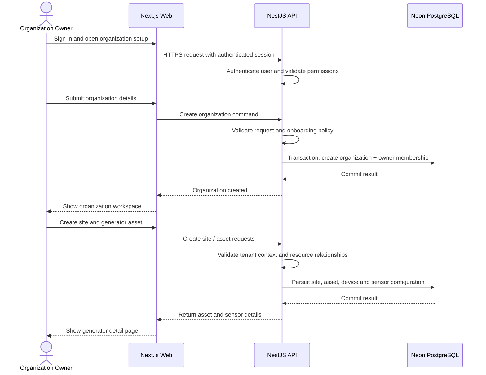
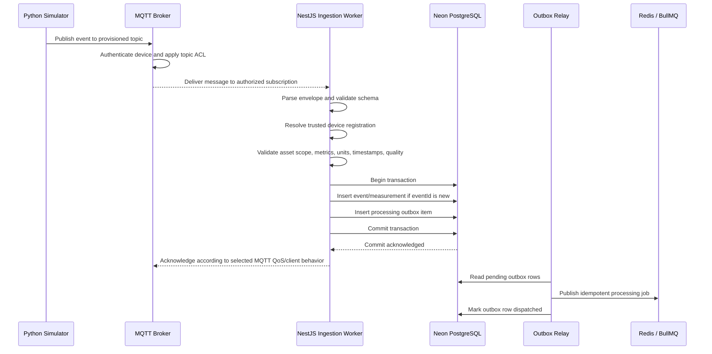
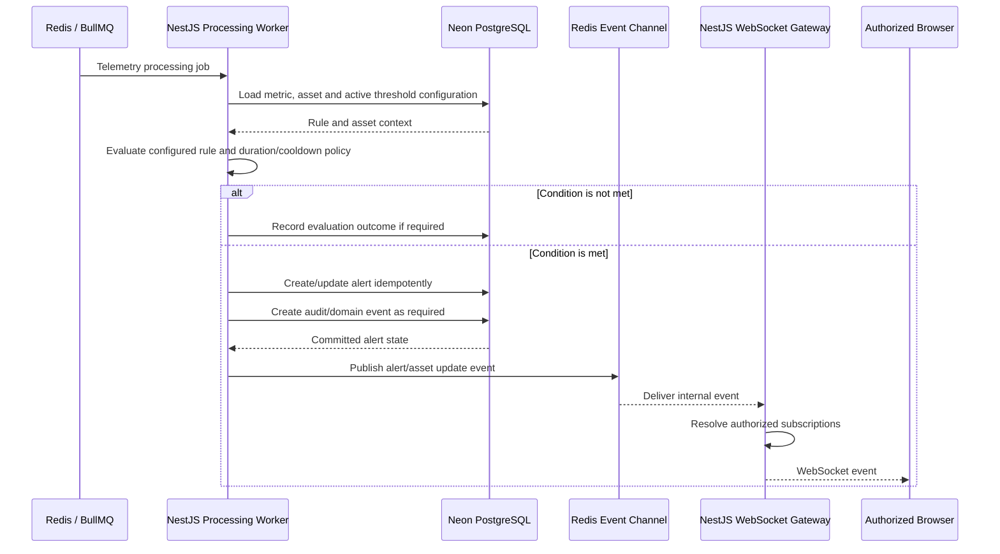
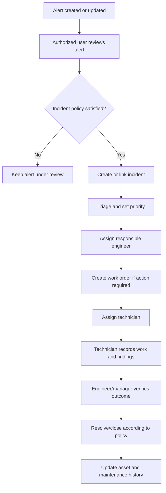
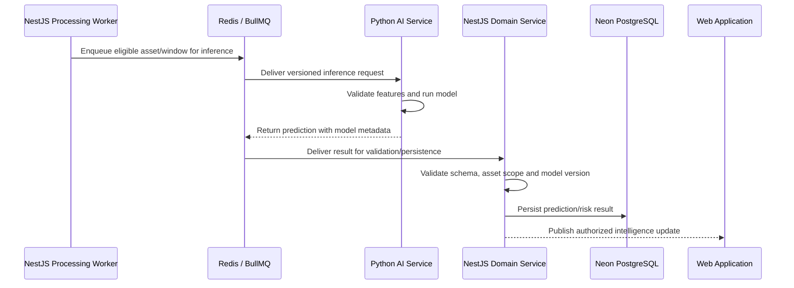

# GridAware — Data Flow Overview

**Document ID:** ARC-FLOW-001  
**Version:** 0.1  
**Status:** Proposed baseline for architecture review

---

## 1. Purpose

This document explains how information moves through GridAware. It complements the C4 diagrams by describing the runtime sequence, validation points, durable writes, asynchronous work, user-visible updates, and expected behavior when dependencies fail.

The primary path is the simulator-first generator workflow. The platform must preserve a strict separation between user-command flows (control plane) and telemetry flows (data plane).

## 2. Two Main Flow Categories

### 2.1 Control-plane flows

Control-plane flows are initiated by authenticated users and represent product configuration or workflow actions:

- Create an organization.
- Create a site/building.
- Register an asset.
- Register a device and sensors.
- Configure metrics and thresholds.
- Review an alert.
- Create/assign/resolve an incident.
- Create/assign/complete a work order.

These flows enter through the NestJS API, are authorized against the current user's tenant and role, and persist durable state in Neon PostgreSQL through Prisma.

### 2.2 Data-plane flows

Data-plane flows carry telemetry from a simulator/device producer:

- Generate a measurement.
- Publish to MQTT.
- Authenticate the device and authorize the topic.
- Validate and normalize the message.
- Deduplicate the event.
- Persist measurement records.
- Evaluate rules and queue downstream work.
- Broadcast authorized updates to connected users.

The browser and Next.js application do not subscribe directly to MQTT.

## 3. Flow A — Organization and Asset Setup

### Rules

- The active organization is resolved from authenticated membership context.
- A user-provided organization ID may select context but never grants permission by itself.
- Asset/site/device/sensor relationships must be tenant-consistent.
- Device credentials and device-to-asset mappings are provisioned by trusted backend workflows.
- A simulator must not be able to select any arbitrary tenant or asset in its payload.

## 4. Flow B — Simulator Telemetry Ingestion

### 4.1 Validation stages

**Stage 1 — Broker admission**

- Authenticate the publishing device.
- Check publish permission for the topic.
- Restrict wildcard access.
- Apply connection limits and TLS for hosted paths.

**Stage 2 — Message envelope validation**

- Confirm supported `schemaVersion`.
- Require a non-empty `eventId` and `deviceId`.
- Parse `observedAt` as a valid timestamp.
- Require a metrics array with valid metric names, numeric values, units, and quality.
- Enforce payload size and metric-count limits.

**Stage 3 — Trusted identity and scope resolution**

- Resolve the broker-authenticated device identity.
- Look up the registered device configuration.
- Derive organization, site, and asset from the trusted registry.
- Verify that the topic/device/asset mapping is consistent.
- Ignore or reject tenant/asset authority claimed only in the payload.

**Stage 4 — Data validation**

- Confirm metrics are configured or explicitly allowed.
- Validate units against metric metadata.
- Validate numeric ranges where configured.
- Preserve original observed time.
- Assign ingestion time on the platform side.
- Mark bad-quality or invalid messages explicitly; do not silently coerce them into valid readings.

**Stage 5 — Idempotency and persistence**

- Enforce a unique event identity within the defined producer scope.
- Store the accepted event and measurements.
- Store an outbox entry in the same database transaction for downstream processing.
- If the same event is received again, do not create duplicate measurements, alerts, incidents, or notifications.

### 4.2 Out-of-order and duplicate events

- Duplicate `eventId` values should have no duplicate business effect.
- A delayed event may still be stored with its original `observedAt` if it passes validation and retention policy.
- The latest-value view must be determined by measurement event time and validity rules, not simply by last arrival time.
- Ingestion metadata should distinguish first receipt, duplicate receipt, processing status, and rejection reason where appropriate.

### 4.3 Acknowledgement principle

The system should acknowledge successful durable ingestion only after the database transaction has committed. Exact acknowledgement timing depends on MQTT QoS and client-library behavior and must be verified in implementation tests. The design must not acknowledge a message as durably accepted before the data and required outbox intent are safely committed.

## 5. Flow C — Rule Evaluation and Alert Creation

### Alert principles

- An alert represents evidence of a configured condition, not proof of equipment failure.
- The alert stores the rule identifier/version or immutable threshold snapshot used during evaluation.
- Sustained conditions should be grouped or suppressed using documented deduplication/cooldown logic.
- A cleared condition should update the alert lifecycle according to the selected alert state model.
- Missing/stale telemetry creates a data-quality or connectivity condition; it must not be treated as healthy.
- Threshold values are configuration, not universal safety guidance. Equipment-specific values must be provided or reviewed by qualified personnel.

## 6. Flow D — Alert to Incident to Work Order

### Workflow constraints

- Not every alert creates an incident automatically.
- Incident creation can depend on severity, duration, recurrence, asset criticality, and organization policy.
- The system records who performed each transition and when.
- Reassignments and reopening must preserve prior history.
- Closing an incident requires a resolution summary.
- Technician updates are limited to assigned/authorized work orders.
- A work order and incident are related but distinct records: one incident may have multiple work orders, and a work order may exist without an incident for planned maintenance.

## 7. Flow E — User-Initiated API Request

1. Browser sends an HTTPS request to the NestJS API.
2. API authenticates the caller.
3. API resolves active organization context from authenticated membership.
4. Guard/policy checks role, permission, and resource scope.
5. DTO validation runs before domain logic.
6. Domain service executes the requested operation.
7. Prisma persists the transaction in Neon PostgreSQL.
8. API returns a stable response or a normalized error.
9. An audit record is created for important administrative/operational changes.

The exact authentication/session strategy remains open. The invariant is that authorization is always enforced server-side.

## 8. Flow F — Real-Time Update Delivery

The initial proposal is:

1. Worker/API commits a durable state change.
2. A lightweight internal event is emitted using Redis Pub/Sub or a queue event channel.
3. The NestJS WebSocket gateway receives the event.
4. The gateway checks which authenticated connections are subscribed to the relevant organization/site/resource.
5. Only authorized clients receive the event.
6. The client updates the relevant view or invalidates/refetches the affected query.

WebSocket messages are notifications that state changed; they are not the durable source of truth. If a client disconnects, it must recover by fetching the latest data from the REST API after reconnecting.

## 9. Flow G — Future AI Inference

This is a future increment. The first product milestone should work using telemetry persistence and deterministic threshold rules without requiring an AI model.

AI results must include, where applicable:

- Asset and measurement-window reference.
- Model name and immutable version.
- Prediction timestamp.
- Prediction horizon.
- Result and units/labels.
- Confidence or calibrated probability metadata only when validated.
- Feature/explanation metadata where supported.
- Data-quality and model-status context.

A failed or timed-out inference must be represented as unavailable/pending/failed, never as a safe or healthy result.

## 10. Flow H — Stale Sensor Detection

A scheduled worker evaluates the last valid observation time for each active sensor/device.

1. Read expected sample interval and permitted grace period.
2. Compare current time against the latest valid `observedAt`/ingestion state.
3. Mark the sensor as delayed/stale/offline according to policy.
4. Create or update a connectivity/data-quality alert if the condition persists.
5. Notify authorized users according to preferences.
6. Clear/resolve the connectivity condition when valid data resumes.

The UI must clearly distinguish:

- Healthy / current data.
- Delayed or stale data.
- Offline / no recent data.
- Invalid or degraded-quality data.
- Unknown state (insufficient evidence).

No state should be inferred as healthy simply because data is missing.

## 11. Reliability and Retry Rules

| Situation | Expected handling |
|---|---|
| Invalid MQTT payload | Reject/quarantine with reason and increment observable failure metrics |
| Unknown device | Reject; do not trust payload scope; record security/diagnostic event without leaking tenant information |
| Duplicate event | Ignore idempotently; no duplicate alert/incident/notification |
| Database failure before commit | Do not mark the event durably accepted; retry according to bounded policy |
| Redis unavailable after data commit | Retain outbox intent; retry dispatch when Redis recovers |
| Worker crash after job pickup | Job may retry; handler must be idempotent |
| AI timeout | Mark inference pending/failed and retry safely; core rule workflow continues |
| WebSocket disconnected | Client refetches current state on reconnect |
| Notification delivery failure | Keep in-app record and retry/record external delivery state separately |

## 12. Data-Lineage and Audit Requirements

For a telemetry-derived alert, the platform should be able to trace:

`Device → Sensor → Metric Reading → Rule Version → Alert → Incident → Work Order → Maintenance Record`

The lineage should retain stable identifiers and timestamps. It should be possible to explain which telemetry event(s) and rule version contributed to an alert. Sensitive data and secrets must not be copied into audit payloads.

## 13. Flow-Level Acceptance Tests

- A valid simulator event is accepted only for its provisioned device/asset scope.
- A payload that claims a different organization or asset cannot override the device registry.
- Replayed event IDs do not create duplicate telemetry effects.
- A delayed reading retains its original observation timestamp.
- A failed downstream queue dispatch is recovered from the durable outbox.
- A threshold condition creates one grouped alert according to its cooldown policy.
- Stale telemetry is presented as stale/offline, not healthy.
- Only authorized users receive site/organization real-time events.
- AI unavailability does not stop telemetry persistence or threshold alerting.
- An incident/work-order lifecycle preserves the actor, action, and timestamp for each transition.
