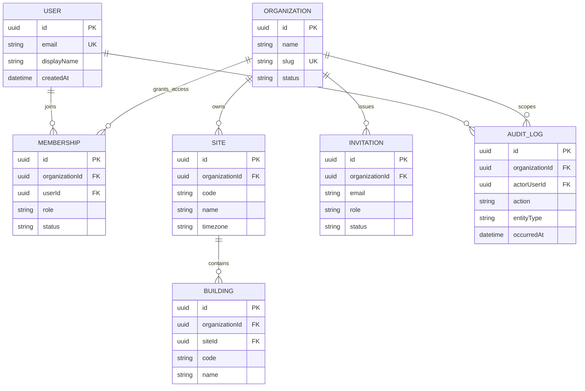
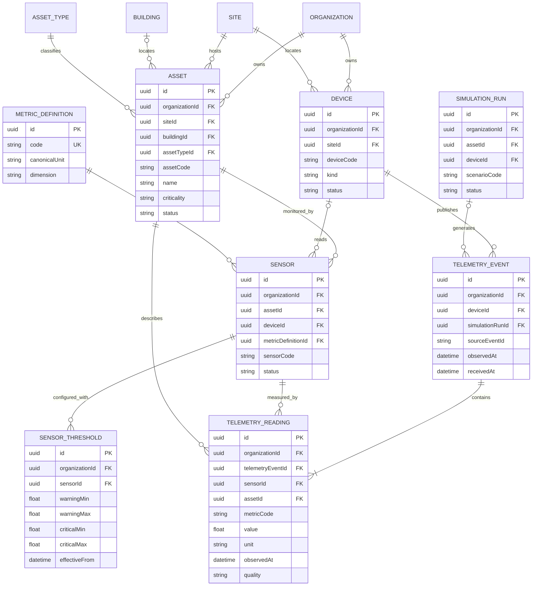
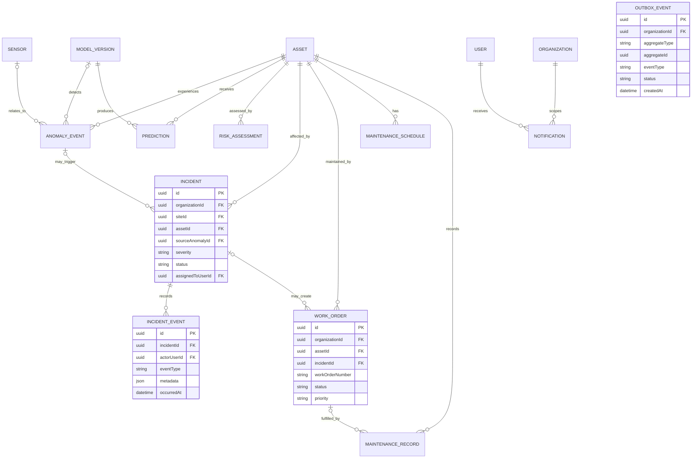

# GridAware — Database Entity Relationship Diagram

**Document ID:** ARC-DB-ERD-001  
**Version:** 0.1  
**Status:** Proposed logical ERD  
**Notation:** Mermaid ER diagram; not an executable migration

---

## 1. Reading the ERD

The diagram is a logical relationship map. It intentionally separates domains and omits some implementation details such as indexes, enum definitions, audit columns, and composite tenant-safety constraints. Those are described in the Entity Catalog and Multi-Tenancy documents.

`Organization` is the tenant boundary. A User is global; its organization access is represented by Membership.

## 2. Identity, Organization, and Facility Model

## 3. Infrastructure and Telemetry Model

## 4. Intelligence and Operations Model

## 5. Key Relationship Notes

### Organization scoping

All tenant-owned models shown with `organizationId` must be scoped by the authenticated organization context. Organization ownership is repeated on high-volume or tenant-sensitive records where it helps enforce constraints and filter queries efficiently.

### Site and Building

An Asset belongs to one Site. `buildingId` is optional. If present, the selected Building must belong to the same Site and Organization as the Asset. The write path must validate this; the database implementation should use composite constraints where practical.

### Device and Sensor

A Device is a message producer/gateway. A Sensor is a measurement source. One Device may publish for multiple Sensors. A Sensor may be unassigned during provisioning, but a reading is accepted only when the authenticated Device is authorized to publish for that Sensor.

### Event and Reading

One Telemetry Event represents one received envelope and has one stable source event identity. It may contain multiple Telemetry Readings. Event-level uniqueness handles duplicate message delivery; reading-level constraints prevent duplicate samples within the same envelope.

### Anomaly and Incident

An Anomaly Event is detection evidence. An Incident is a workflow case. Policies decide whether to create, attach to, or deduplicate an Incident based on one or more anomaly events.

### Incident and Work Order

An Incident may have zero or more Work Orders depending on operational policy. A Work Order can also be created independently for preventive maintenance.

## 6. Logical ERD Limitations

This ERD does not yet express:

- Composite foreign keys required to guarantee tenant/site consistency at database level.
- Partial/covering indexes.
- Unique constraints for deduplication keys.
- Exact enum values and allowed transitions.
- Partitioning or retention implementation.
- RLS policies.
- Foreign-key delete/update behavior.

These must be resolved in the schema design and migrations. A visually correct ERD alone is not sufficient database validation.
