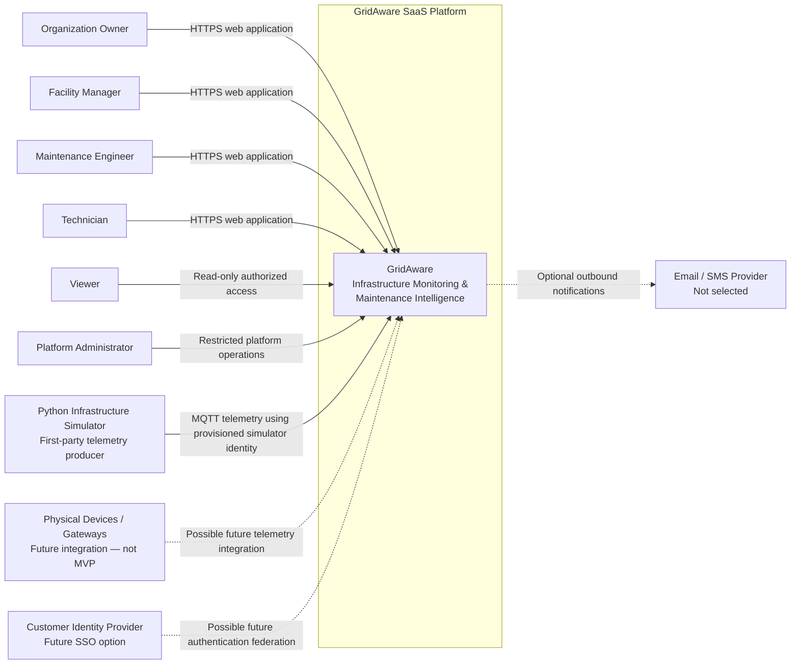

# GridAware — System Context

**Document ID:** ARC-SYS-001  
**Version:** 0.1  
**Status:** Draft for architecture review  
**Related baseline:** GridAware PRD v1.0  
**Architecture level:** C4 Level 1 — System Context

---

## 1. Executive Summary

GridAware is a multi-tenant B2B SaaS platform that helps organizations monitor infrastructure assets, understand operating conditions, detect configured abnormal conditions, and coordinate maintenance work.

The initial release operates with simulated equipment telemetry. A first-party Python simulator represents a generator and its sensors. It publishes messages to an MQTT broker. GridAware's ingestion and processing runtime validates those messages, resolves the publishing device to its registered organization/site/asset context, stores accepted telemetry in Neon PostgreSQL, evaluates configured rules, and exposes results to authorized users through the web application.

The platform provides operational visibility and workflow coordination. It is **not** an industrial control system and does not send commands to generators, PLCs, electrical protection devices, HVAC controllers, or other physical equipment.

## 2. System Purpose

GridAware exists to answer five operational questions for an organization:

1. What infrastructure assets exist, and where are they located?
2. What is the latest known operating condition of each asset?
3. Which telemetry measurements or operating conditions require attention?
4. Why was an alert or incident created, and what information supports investigation?
5. Who owns the investigation or maintenance action, and what was done?

The system combines asset context, telemetry, monitoring, alert/incident workflows, and maintenance records. Predictive intelligence may extend this capability after the telemetry pipeline and deterministic rules are reliable.

## 3. System Boundary

### 3.1 Inside the GridAware product boundary

The GridAware SaaS system includes the following capabilities, even when deployed as multiple containers:

- Browser-facing web application.
- Backend API and domain services.
- Background ingestion and processing workers.
- MQTT broker used by the simulator in the initial operating mode.
- Redis-backed background job and event distribution infrastructure.
- Neon PostgreSQL database.
- In-app notification and real-time update capability.
- Future Python AI inference service, when the intelligence increment is introduced.

The C4 container view breaks the system into these runtime parts. They remain one logical product.

### 3.2 Outside the core SaaS application boundary

- Human users and their browsers.
- The first-party simulator as a telemetry producer/tool. It is controlled by the GridAware team in development/demo environments; whether it is deployed as a customer-facing hosted simulation capability is an open release decision.
- External email/SMS/push provider, if selected later.
- Physical field devices, gateways, PLCs, SCADA platforms, and customer OT networks. These are future integration possibilities and are not required for the simulator-only MVP.
- Customer identity providers such as Microsoft Entra ID or Google Workspace. Enterprise SSO is not assumed for the first MVP.

## 4. Primary People

### 4.1 Customer users

| Person / Role | Primary goal | Main interaction with GridAware |
|---|---|---|
| Organization Owner | Establish and administer the tenant | Creates organization, manages members, roles, and organization settings |
| Facility Manager | Maintain visibility across assigned facilities | Reviews dashboard, assets, alerts, incidents, and maintenance progress |
| Maintenance Engineer | Investigate equipment conditions | Reviews telemetry and alert context, manages incidents and work orders |
| Technician | Execute assigned maintenance work | Reviews assigned work orders, records findings and completion details |
| Viewer | Read operational information | Views permitted dashboards, assets, incidents, and reports without editing |

A user may hold different memberships in different organizations. An active organization context must be validated against the authenticated user's membership and permissions.

### 4.2 Internal platform operator

A Platform Administrator operates the SaaS platform itself. This is not an ordinary customer role. Platform-level support access must be explicit, least-privilege, and audited. It must not become an unrestricted shortcut around tenant isolation.

## 5. Neighboring Systems and External Participants

| External participant/system | Relationship to GridAware | MVP status |
|---|---|---|
| User's web browser | Accesses the Next.js application and its authenticated workflows | Required |
| Python infrastructure simulator | Publishes synthetic generator telemetry using a provisioned device identity | Required for initial operating mode |
| Email/SMS provider | Delivers outbound notifications beyond in-app notifications | Provider not selected; optional/later |
| Physical sensor/gateway | Could publish real equipment telemetry in a later integration | Out of scope for initial simulator-only release |
| Customer IdP | Could provide enterprise SSO | Not required for initial MVP |
| External observability service | May receive logs, metrics, and traces | Provider not selected; implementation choice remains open |

## 6. System Context Diagram

The following diagram shows the product as one logical system. Internal runtime containers are intentionally hidden at this level.

### 6.1 Relationship catalogue

| Source | Target | Interaction | Data / intent | Trust note |
|---|---|---|---|---|
| Organization Owner | GridAware | HTTPS | Tenant setup, members, roles, settings | Authenticated customer membership required |
| Facility Manager | GridAware | HTTPS | Site and asset visibility, alerts, operations | Organization and site scope validated server-side |
| Maintenance Engineer | GridAware | HTTPS | Telemetry review, incident and work-order operations | Permission checked for each resource and action |
| Technician | GridAware | HTTPS | Assigned work orders and execution records | Limited to authorized/assigned operational records |
| Viewer | GridAware | HTTPS | Read-only views and reports | Read-only permissions enforced by API |
| Platform Administrator | GridAware | Restricted HTTPS/admin interface | Platform support and operations | Separate privileged access with audit trail |
| Simulator | GridAware | MQTT | Synthetic telemetry and simulated device state | Device credentials and broker ACL; payload IDs are not trusted as tenant authority |
| GridAware | Email/SMS provider | HTTPS API (future) | Outbound delivery request | Secrets, retries, provider selection, and user consent required |
| Physical gateway | GridAware | MQTT/HTTPS (future) | Real equipment telemetry | Not part of initial release; requires OT security review |
| Customer IdP | GridAware | OIDC/SAML (future) | Federated authentication | Not required for MVP; protocol and provider undecided |

## 7. High-Level Responsibilities

### 7.1 GridAware is responsible for

- Authenticating users and resolving their authorized organization context.
- Enforcing role- and resource-level access rules.
- Managing organizations, sites, buildings, assets, devices, and sensors.
- Defining metric metadata and configured threshold rules.
- Receiving, validating, deduplicating, and storing telemetry.
- Indicating data freshness and sensor/device connectivity state.
- Evaluating deterministic threshold/rule conditions.
- Creating and maintaining alerts and incidents according to policy.
- Managing work orders, assignments, maintenance records, and audit history.
- Providing authorized dashboard, historical, and real-time views.
- Orchestrating optional AI inference and persisting product-facing results after that increment is approved.

### 7.2 GridAware is not responsible for in the MVP

- Controlling machinery or changing its operating setpoints.
- Acting as a PLC, SCADA, protection relay, building management controller, or safety system.
- Certifying that an asset is safe to operate.
- Guaranteeing that a predicted failure will occur.
- Replacing OEM maintenance instructions or qualified engineering judgment.
- Validating the simulator's synthetic values as real-world equipment specifications.
- Automatically dispatching field technicians through an external workforce system.

## 8. Key Context Constraints

### 8.1 Simulator-only initial operating mode

All initial telemetry must be explicitly identified as simulated. The source and scenario should be traceable. The product UI must not present simulated measurements as measurements collected from physical equipment.

### 8.2 Multi-tenant SaaS

The organization is the primary customer data-isolation boundary. The backend must validate that the authenticated user has membership and permission for the requested organization and resource. The client-provided organization ID or slug is only a selector; it is not proof of authorization.

### 8.3 Device identity and tenant resolution

A telemetry payload must not be allowed to self-assign an organization, site, or asset. The authenticated device identity and trusted device registry determine which asset the producer is allowed to report for. MQTT topic names support routing and ACL enforcement but are not, by themselves, a security boundary.

### 8.4 Monitoring and decision support only

The MVP is read/observe/record oriented. No control path from GridAware to physical equipment is included. Future control integrations would require a separate product, safety, and OT security review.

### 8.5 AI is not on the critical telemetry persistence path

The platform must be able to authenticate users, manage assets, accept valid telemetry, persist telemetry, and evaluate deterministic rules even when a future AI service is unavailable.

## 9. Quality Attributes at the Context Level

| Quality attribute | Architectural concern | Evidence required later |
|---|---|---|
| Security | Tenant isolation, user authorization, device identity, secret handling | Negative authorization tests, security review, audit evidence |
| Reliability | Accepted telemetry must not silently disappear; duplicate events must not create duplicate business effects | Retry/failure tests, queue monitoring, idempotency tests |
| Performance | Bounded API and telemetry processing under an explicit test workload | Load tests and p95/p99 measurements |
| Data integrity | Correct asset linkage, units, event time, and ingestion time | Contract tests and database constraints |
| Usability | Stale/offline data must not look healthy; alerts need context | UX acceptance tests and user review |
| Maintainability | Domain responsibilities and system boundaries remain understandable | Module ownership, dependency rules, automated checks |
| Auditability | Important configuration and workflow changes are traceable | Audit-event coverage and review |

## 10. Context-Level Security Boundaries

1. **User-to-platform boundary:** All browser traffic is encrypted in hosted environments. Requests require authentication and server-side authorization.
2. **Simulator-to-broker boundary:** Simulator credentials are scoped to a device identity and allowed publish topics.
3. **Broker-to-worker boundary:** The worker consumes authorized telemetry channels and validates each message against a trusted device registry.
4. **Application-to-database boundary:** Only trusted backend runtimes access Neon. The browser never connects directly to PostgreSQL.
5. **Backend-to-AI boundary:** Future AI requests use an internal authenticated interface with bounded payloads, timeouts, and versioned contracts.
6. **Platform-administrator boundary:** Privileged support operations are separated and audited.

## 11. System Context Acceptance Criteria

The context design is acceptable when:

- The system purpose and boundary can be explained without referring to implementation classes.
- All customer roles and the internal platform operator are identified.
- The simulator's place in the system is clear.
- Future physical-device integrations are visibly marked as future, not MVP.
- The platform's no-control-command boundary is explicit.
- Multi-tenant and device trust boundaries are documented.
- AI is described as optional/future to the core telemetry workflow.
- All external providers that remain unselected are marked as undecided.

## 12. Open Questions

See [open-architecture-decisions.md](./open-architecture-decisions.md). The most important context-level questions are the production hosting arrangement for the simulator-only demo, the user authentication/session design, and the notification provider for outbound messages.
