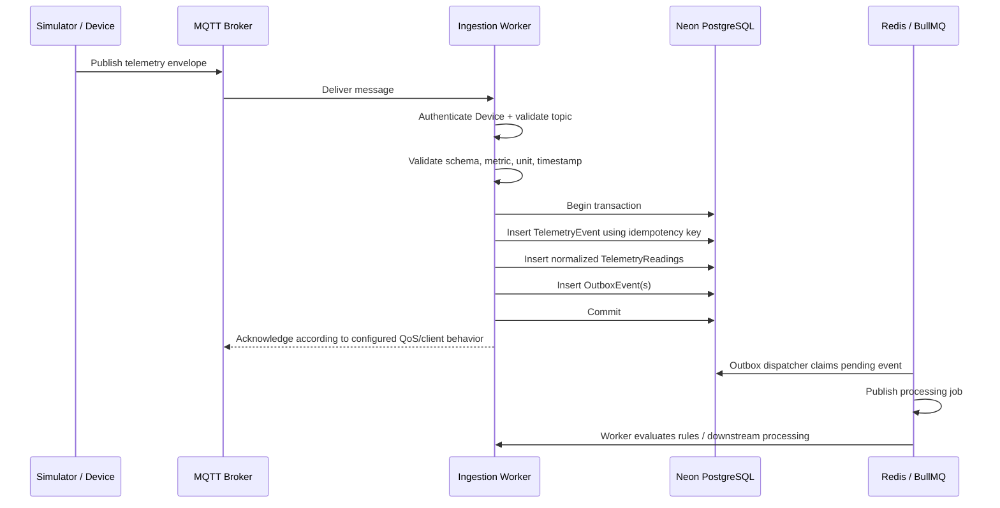

# GridAware — Telemetry Storage Architecture

**Document ID:** ARC-DB-TEL-001  
**Version:** 0.1  
**Status:** Proposed MVP design

---

## 1. Goals

The telemetry design must support the simulator-first generator workflow and later physical-device integration without changing the core domain model.

Required capabilities:
- Accept one message containing one or multiple sensor measurements.
- Preserve the original event identity and timestamps.
- Normalize units and validate sensor/device ownership.
- Prevent duplicate event ingestion.
- Store per-measurement values and quality.
- Query history by organization, site, asset, sensor, metric, and time range.
- Distinguish event time from receive time.
- Trace generated readings to a Simulation Run.
- Continue accepting telemetry when an AI service is unavailable.

## 2. Selected Logical Model

Use two core tables:

1. `TelemetryEvent`: one source message/envelope.
2. `TelemetryReading`: one normalized measurement inside that envelope.

This is the proposed MVP model. It is not a claim that one PostgreSQL table design will scale indefinitely.

### 2.1 Telemetry Event Envelope

The event envelope contains:
- Internal event UUID.
- Organization ID.
- Authenticated Device ID.
- Source event ID supplied by the publisher.
- Source (`SIMULATOR`, `DEVICE`, `IMPORT`).
- Schema version.
- Observed timestamp.
- Received timestamp.
- Event validation/quality status.
- Optional Simulation Run ID.
- Optional raw payload and payload hash.

Idempotency key: `(organizationId, deviceId, sourceEventId)`.

### 2.2 Telemetry Reading

A reading contains:
- Organization ID.
- Parent Telemetry Event ID.
- Sensor ID.
- Asset ID (denormalized for query and consistency checks).
- Metric code.
- Normalized numeric value.
- Canonical unit.
- Observed timestamp.
- Quality (`VALID`, `SUSPECT`, `INVALID`).
- Normalization/contract version.

Initial rule: one reading per Sensor per event. If a future message supports multiple samples for a single Sensor, add a stable sample index and revise the unique key before enabling that payload shape.

## 3. Ingestion Sequence

The exact MQTT acknowledgement behavior depends on the selected client library and QoS mode and must be proven in integration tests. The intended reliability rule is: do not acknowledge a message as durably accepted before its event/readings transaction commits, where the client/broker protocol permits explicit control.

## 4. Validation Pipeline

### Stage A — Publisher and topic authorization

- Resolve Device from authenticated MQTT credential and topic ACL.
- Confirm Device is active and not revoked.
- Confirm the topic maps to the authorized organization/site/device.
- Do not trust organization/resource identifiers from the payload.

### Stage B — Envelope validation

- JSON/schema version supported.
- Stable sourceEventId present.
- Timestamp parseable and within allowed future-skew bounds.
- Metric array non-empty and below configured maximum size.
- No unknown/unauthorized Sensor keys.
- Payload size below configured limit.

### Stage C — Reading validation and normalization

- Sensor belongs to the Device's authorized scope.
- Sensor belongs to the Asset/site/organization expected by the registry.
- Metric matches Sensor's configured Metric Definition.
- Input unit is allowed for the metric.
- Convert to canonical unit using a tested conversion function.
- Reject non-finite values (NaN/Infinity) and impossible values according to metric validation policy.
- Assign data quality; preserve suspect/invalid status rather than silently correcting data.

### Stage D — Persistence and durable handoff

- Insert envelope idempotently.
- Insert readings atomically with the envelope.
- Persist outbox event in the same transaction for downstream processing.
- Only then signal durable acceptance, subject to MQTT acknowledgement semantics.

## 5. Duplicate and Retry Handling

MQTT delivery may be repeated, publishers may retry after disconnect, and workers may retry jobs. Ingestion must be idempotent.

Rules:
- Duplicate `(organizationId, deviceId, sourceEventId)` must not create another event/readings set.
- Return/record a duplicate outcome without producing duplicate anomaly/incident jobs.
- A duplicate payload with a different hash should be observable as an integrity conflict, not silently overwrite the original event.
- Downstream jobs must carry stable idempotency identifiers.
- Outbox delivery may occur more than once; consumers must be idempotent.

## 6. Event Time vs Receive Time

- `observedAt`: when the sensor measurement was produced.
- `receivedAt`: when GridAware accepted the envelope.
- `createdAt`: when the database row was persisted.

Historical charts should use `observedAt`. Ingestion-lag monitoring should use `receivedAt - observedAt`. Freshness should use the latest valid observed/received values and configured stale interval. Do not use database create time as a substitute for sensor time.

Late and out-of-order messages are valid operational possibilities. The data model must retain them with their original observedAt rather than rewriting timestamps to insertion order.

## 7. Quality and Missing Data

Recommended per-reading quality states:

- `VALID`: schema, ownership, metric, unit, and numeric checks passed.
- `SUSPECT`: accepted with a quality warning (for example, an unexpected but not impossible jump or known device quality flag).
- `INVALID`: retained only in a quarantine/diagnostic path if policy permits; excluded from trusted charts/model features.

Not every malformed message should be inserted into the normalized reading table. Preserve a bounded rejection record or structured log for diagnostics, with sensitive payload redaction.

Missing measurement is not a zero. No reading is not evidence of normal behavior. Sensor freshness must be represented explicitly in the UI and AI feature pipeline.

## 8. Raw Payload Policy

The raw message is useful for debugging contract evolution, but it may contain unneeded data and increases storage cost.

Proposed policy:
- Keep normalized measurements as the primary query surface.
- Store raw payload only if needed for diagnostics or replay.
- Apply short, configurable retention to raw payloads, separate from normalized telemetry retention.
- Redact credentials, tokens, or personal data before persistence/logging.
- Record schema version and normalization version so processing can be reproduced.

Exact retention duration is an open product/operational decision and must be finalized before a production pilot.

## 9. Downstream Processing Boundaries

Telemetry persistence must not depend on AI availability.

After commit, an outbox/queue workflow may trigger:
- Deterministic threshold evaluation.
- Sensor/device freshness update.
- Anomaly detection.
- Aggregation/analytics update.
- Real-time dashboard fan-out.

The initial MVP should implement deterministic threshold evaluation first. ML anomaly detection can consume the same normalized readings later.

## 10. Query Patterns

Required queries:
1. Latest readings for all sensors in a Site.
2. Time range for one Sensor + Metric.
3. Time range for one Asset across Sensors.
4. Latest valid reading + quality + receivedAt for freshness.
5. Downsampled time series for charts at different ranges.
6. Telemetry around an Anomaly/Incident window.
7. Ingestion rate and lag by Device/Site/Organization.

All queries must include organization scope, bounded time windows, and a maximum result/point count.

## 11. Simulator Provenance

Every simulator-originated event must:
- Use source `SIMULATOR`.
- Reference a valid SimulationRun.
- Be traceable to the scenario code, simulator version, and configuration.
- Be displayed as simulated data in monitoring, incident evidence, exports, and demo reports.
- Be isolated from physical-device namespaces and credentials.

A user must not be able to relabel simulator telemetry as physical-device telemetry by changing a payload field.

## 12. Growth Strategy

Start with PostgreSQL-native storage on Neon. Before introducing partitioning or a separate time-series store, benchmark:
- Sustained and burst writes.
- Read/write transaction contention.
- Index size and vacuum behavior.
- Hot-range query latency.
- Long-range chart query performance.
- Retention/delete workload.
- Connection count and pool pressure.

Potential later options include native range partitioning, rollup tables, object storage for long-term raw archives, or a dedicated time-series platform. No option is selected until measurements show a need and the Neon plan supports the required features.
