# GridAware — Application Sitemap

**Document version:** 1.0  
**Status:** Draft for review  
**Depends on:** `information-architecture.md`  
**Product baseline:** GridAware PRD v1.0  
**Application model:** Multi-tenant B2B SaaS  
**Initial mode:** Simulator-only telemetry

---

## 1. Purpose

This document translates the approved Information Architecture into a practical page and route structure for the GridAware web application.

It defines:

- Public, onboarding, and authenticated areas.
- Primary navigation groups and their child destinations.
- Proposed Next.js route patterns.
- Page purpose and expected content.
- Role visibility and action expectations.
- Parent-child relationships and contextual navigation.
- MVP, later-release, and internal-only destinations.

The sitemap is a UX structure, not an authorization specification. Every route and resource must still be protected by server-side authentication, tenant membership, and permission checks.

## 2. Route Conventions

### 2.1 URL baseline

Use a stable, version-independent frontend route structure. API versioning is separate from frontend routes.

Recommended authenticated route prefix:

```text
/app
```

The active organization should be resolved from the authenticated session and selected organization context. Do not rely on a client-provided organization ID as proof of access.

### 2.2 Dynamic route parameters

Use readable resource parameters:

- `[siteId]`
- `[buildingId]`
- `[assetId]`
- `[sensorId]`
- `[alertId]`
- `[incidentId]`
- `[workOrderId]`
- `[memberId]`

The route parameter identifies the requested resource only. The backend must verify that the resource belongs to the active organization and that the user may access it.

### 2.3 Query parameters

Query parameters are appropriate for shareable list filters, pagination, and date ranges. Example:

```text
/app/monitoring/telemetry?assetId=asset_123&metric=temperature&range=24h
```

Avoid putting secrets, personal data, or authorization claims in query strings.

## 3. High-Level Sitemap

```mermaid
flowchart TD
    A[GridAware] --> B[Public]
    A --> C[Authenticated App]
    A --> D[Platform Operations - Internal]

    B --> B1[Login]
    B --> B2[Register]
    B --> B3[Accept Invitation]
    B --> B4[Forgot / Reset Password]

    C --> C1[Dashboard]
    C --> C2[Infrastructure]
    C --> C3[Monitoring]
    C --> C4[Alerts]
    C --> C5[Incidents]
    C --> C6[Work Orders]
    C --> C7[Maintenance]
    C --> C8[Analytics]
    C --> C9[Administration]
    C --> C10[Profile & Preferences]

    C2 --> C2A[Sites]
    C2 --> C2B[Buildings]
    C2 --> C2C[Assets]
    C2 --> C2D[Sensors & Devices]

    C3 --> C3A[Live Monitoring]
    C3 --> C3B[Telemetry Explorer]

    C4 --> C4A[Alert Queue]
    C4 --> C4B[Alert Details]

    C5 --> C5A[Incident Queue]
    C5 --> C5B[Incident Details]

    C6 --> C6A[Work Order Queue]
    C6 --> C6B[Work Order Details]

    C7 --> C7A[Maintenance History]
    C7 --> C7B[Maintenance Schedules - Later]

    C9 --> C9A[Members]
    C9 --> C9B[Roles & Permissions]
    C9 --> C9C[Organization Settings]
    C9 --> C9D[Audit Log]
```



## 4. Complete Route Tree

### 4.1 Public and authentication routes

| Route              | Page                       | Purpose                                                                   | Availability                          |
| ------------------ | -------------------------- | ------------------------------------------------------------------------- | ------------------------------------- |
| `/`                | Public landing or redirect | Product entry point; redirect authenticated users to `/app/dashboard`     | P0 minimal                            |
| `/login`           | Login                      | Authenticate an existing user                                             | P0                                    |
| `/register`        | Registration               | Create an account, subject to onboarding rules                            | P0 if self-registration is enabled    |
| `/invite/accept`   | Accept invitation          | Join an organization through a valid invitation                           | P0                                    |
| `/forgot-password` | Forgot password            | Start password recovery                                                   | P0 if password authentication is used |
| `/reset-password`  | Reset password             | Complete password reset using a valid token                               | P0 if password authentication is used |
| `/auth/callback`   | Auth callback              | Complete an authentication provider flow if an external provider is added | Later / provider-dependent            |

Public registration policy is an open product decision. If accounts are invitation-only, `/register` should not allow arbitrary organization creation and may be replaced by an invitation-focused flow.

### 4.2 Onboarding routes

| Route                              | Page                 | Purpose                                                                                       | Availability |
| ---------------------------------- | -------------------- | --------------------------------------------------------------------------------------------- | ------------ |
| `/onboarding`                      | Onboarding router    | Determine whether the user must create an organization, accept an invitation, or finish setup | P0           |
| `/onboarding/create-organization`  | Create organization  | Create the first customer tenant for an eligible user                                         | P0           |
| `/onboarding/organization-profile` | Organization profile | Capture required organization details                                                         | P0           |
| `/onboarding/create-site`          | Create first site    | Help a new organization configure its first facility                                          | P0           |
| `/onboarding/invite-team`          | Invite team          | Optional guided invitation step; may be skippable                                             | P0/P1        |
| `/onboarding/complete`             | Onboarding complete  | Confirm setup and enter the application                                                       | P0           |

Onboarding should be resumable. Do not force a user to finish optional steps before accessing the parts of the application their role is allowed to use.

### 4.3 Authenticated application routes

#### Dashboard

| Route            | Page      | Purpose                                           | Availability |
| ---------------- | --------- | ------------------------------------------------- | ------------ |
| `/app`           | App entry | Resolve to the user's default landing destination | P0           |
| `/app/dashboard` | Dashboard | Organization or site-level operational overview   | P0           |

#### Infrastructure

| Route                                              | Page                   | Purpose                                                 | Availability                    |
| -------------------------------------------------- | ---------------------- | ------------------------------------------------------- | ------------------------------- |
| `/app/infrastructure/sites`                        | Sites list             | Browse and manage authorized sites                      | P0                              |
| `/app/infrastructure/sites/new`                    | Create site            | Create a site                                           | P0                              |
| `/app/infrastructure/sites/[siteId]`               | Site overview          | View site summary, assets, recent issues, and activity  | P0                              |
| `/app/infrastructure/sites/[siteId]/edit`          | Edit site              | Edit site metadata                                      | P0                              |
| `/app/infrastructure/buildings`                    | Buildings list         | Browse buildings where the organization uses them       | P1 or P0 if needed by the pilot |
| `/app/infrastructure/buildings/new`                | Create building        | Add a building under a site                             | P1 or P0 if needed by the pilot |
| `/app/infrastructure/buildings/[buildingId]`       | Building details       | View building context and associated assets             | P1 or P0 if needed by the pilot |
| `/app/infrastructure/assets`                       | Assets list            | Browse/filter assets across authorized sites            | P0                              |
| `/app/infrastructure/assets/new`                   | Register asset         | Register an asset such as Generator-01                  | P0                              |
| `/app/infrastructure/assets/[assetId]`             | Asset overview         | View identity, location, current state, and key signals | P0                              |
| `/app/infrastructure/assets/[assetId]/edit`        | Edit asset             | Update permitted asset metadata                         | P0                              |
| `/app/infrastructure/assets/[assetId]/sensors`     | Asset sensors          | View and configure sensors attached to an asset         | P0                              |
| `/app/infrastructure/assets/[assetId]/history`     | Asset history          | View historical telemetry and operational events        | P0                              |
| `/app/infrastructure/assets/[assetId]/maintenance` | Asset maintenance      | View linked work orders and maintenance records         | P0                              |
| `/app/infrastructure/sensors`                      | Sensors & Devices list | Browse sensor/device identities and health              | P0                              |
| `/app/infrastructure/sensors/new`                  | Register sensor        | Register a sensor and map its metric/unit               | P0                              |
| `/app/infrastructure/sensors/[sensorId]`           | Sensor details         | View sensor configuration, status, and measurements     | P0                              |

Buildings and areas are optional levels. A customer must be able to register a site and attach assets directly to it.

#### Monitoring

| Route                                  | Page                     | Purpose                                                                                | Availability                                               |
| -------------------------------------- | ------------------------ | -------------------------------------------------------------------------------------- | ---------------------------------------------------------- |
| `/app/monitoring/live`                 | Live Monitoring          | View live measurements for selected sites/assets                                       | P0                                                         |
| `/app/monitoring/telemetry`            | Telemetry Explorer       | Query historical measurements by asset, sensor, metric, and time range                 | P0 basic                                                   |
| `/app/monitoring/telemetry/[sensorId]` | Sensor telemetry         | Deep-link to a sensor's measurement history                                            | P1; can be handled by sensor details initially             |
| `/app/monitoring/simulator`            | Simulator Control/Status | View simulator status and permitted scenario controls in development/demo environments | P0 for internal demo or explicitly scoped simulator access |

Simulator controls must be permissioned and clearly labeled as simulation. They must never resemble controls for real physical machinery.

#### Alerts

| Route                   | Page          | Purpose                                                         | Availability |
| ----------------------- | ------------- | --------------------------------------------------------------- | ------------ |
| `/app/alerts`           | Alert queue   | Review active and historical alerts                             | P0           |
| `/app/alerts/[alertId]` | Alert details | Review condition, telemetry context, rule, and related incident | P0           |

#### Incidents

| Route                         | Page             | Purpose                                             | Availability                                        |
| ----------------------------- | ---------------- | --------------------------------------------------- | --------------------------------------------------- |
| `/app/incidents`              | Incident queue   | Filter and manage operational incidents             | P0                                                  |
| `/app/incidents/new`          | Create incident  | Manually report an operational problem if permitted | P0/P1; include only if manual reporting is in scope |
| `/app/incidents/[incidentId]` | Incident details | Investigate, assign, record timeline, and resolve   | P0                                                  |

#### Work Orders

| Route                            | Page               | Purpose                                                      | Availability                                                 |
| -------------------------------- | ------------------ | ------------------------------------------------------------ | ------------------------------------------------------------ |
| `/app/work-orders`               | Work-order queue   | View and filter work orders                                  | P0                                                           |
| `/app/work-orders/new`           | Create work order  | Create an inspection or maintenance task                     | P0                                                           |
| `/app/work-orders/[workOrderId]` | Work-order details | Execute and document an assigned task                        | P0                                                           |
| `/app/my-work`                   | My Work            | Focused list of work assigned to the current technician/user | P0 for Technician experience; may be a dashboard tab instead |

#### Maintenance

| Route                                     | Page                       | Purpose                                              | Availability                    |
| ----------------------------------------- | -------------------------- | ---------------------------------------------------- | ------------------------------- |
| `/app/maintenance`                        | Maintenance overview       | Entry point for maintenance history and related work | P0 basic                        |
| `/app/maintenance/records`                | Maintenance records        | Browse completed maintenance records                 | P0 basic                        |
| `/app/maintenance/records/[recordId]`     | Maintenance record details | Review work performed and linked asset/work order    | P1 if separate detail is needed |
| `/app/maintenance/schedules`              | Maintenance schedules      | Browse planned recurring maintenance                 | P1/later                        |
| `/app/maintenance/schedules/new`          | Create schedule            | Configure a recurring schedule                       | Later                           |
| `/app/maintenance/schedules/[scheduleId]` | Schedule details           | View and manage a schedule                           | Later                           |

#### Analytics

| Route                        | Page                  | Purpose                                          | Availability |
| ---------------------------- | --------------------- | ------------------------------------------------ | ------------ |
| `/app/analytics`             | Analytics overview    | Basic trend summaries and site-level comparisons | P0 basic     |
| `/app/analytics/assets`      | Asset analytics       | Asset availability/status summaries              | P1           |
| `/app/analytics/incidents`   | Incident analytics    | Incident counts, severity, and resolution trends | P1           |
| `/app/analytics/maintenance` | Maintenance analytics | Work-order and maintenance trends                | P1           |

Do not expose a page that contains only placeholder charts. If a metric is not supported by sufficient data, show a clear empty or unavailable state and explain what data is needed.

#### Administration

| Route                              | Page                     | Purpose                                               | Availability                                                 |
| ---------------------------------- | ------------------------ | ----------------------------------------------------- | ------------------------------------------------------------ |
| `/app/settings`                    | Settings entry           | Redirect to organization settings or profile settings | P0                                                           |
| `/app/settings/organization`       | Organization settings    | View/update organization profile and defaults         | P0                                                           |
| `/app/settings/members`            | Members                  | Invite, view, and manage organization members         | P0                                                           |
| `/app/settings/members/[memberId]` | Member details           | Review membership and role assignment                 | P1; can be a drawer initially                                |
| `/app/settings/roles`              | Roles & permissions      | Explain the available roles and permissions           | P0 read-only matrix; editing depends on authorization design |
| `/app/settings/audit-log`          | Audit log                | Review important organization actions                 | P0 minimum                                                   |
| `/app/settings/notifications`      | Notification preferences | Manage user notification preferences                  | P1                                                           |

#### User profile

| Route                      | Page                 | Purpose                                      | Availability                             |
| -------------------------- | -------------------- | -------------------------------------------- | ---------------------------------------- |
| `/app/profile`             | My Profile           | View/update user profile details             | P0                                       |
| `/app/profile/preferences` | Preferences          | Time zone, display, and personal preferences | P1                                       |
| `/app/notifications`       | Notifications center | View recent in-app notifications             | P0 if in-app notifications are delivered |

### 4.4 Internal platform operations routes

These routes are for GridAware operators, not customer organization members. They should use a separate authorization boundary and preferably a separate application shell.

| Route                                      | Page              | Purpose                                           | Availability                                 |
| ------------------------------------------ | ----------------- | ------------------------------------------------- | -------------------------------------------- |
| `/platform`                                | Platform overview | Internal service/tenant overview                  | Internal only; not required for customer MVP |
| `/platform/organizations`                  | Tenant directory  | Support/operations view of customer organizations | Internal only                                |
| `/platform/organizations/[organizationId]` | Tenant detail     | Review tenant metadata and support status         | Internal only                                |
| `/platform/audit`                          | Platform audit    | Review privileged platform actions                | Internal only                                |

Do not expose these routes in customer navigation. Support access to customer information must be purpose-limited and audited.

## 5. Sidebar Sitemap

The recommended desktop sidebar order is:

```text
GRID AWARE

Workspace
  Dashboard

Infrastructure
  Sites
  Buildings             (conditional / optional)
  Assets
  Sensors & Devices

Monitoring
  Live Monitoring
  Telemetry Explorer

Operations
  Alerts
  Incidents
  Work Orders
  Maintenance

Insights
  Analytics

Administration
  Members
  Roles & Permissions  (Owner/admin)
  Organization Settings
  Audit Log            (Owner/admin)

[User Profile]
[Notifications]
```

This grouping places Alerts, Incidents, and Work Orders together as operational work while keeping their conceptual difference visible. If usability testing shows that users expect Alerts as a distinct top-level group, it may be promoted without changing the URL structure.

## 6. Role-Based Landing Destinations

| Role                 | Default landing destination                                | Secondary shortcuts                              |
| -------------------- | ---------------------------------------------------------- | ------------------------------------------------ |
| Organization Owner   | `/app/dashboard`                                           | Sites, Members, Organization Settings, Audit Log |
| Facility Manager     | `/app/dashboard`                                           | Sites, Alerts, Incidents, Work Orders            |
| Maintenance Engineer | `/app/dashboard` or `/app/alerts` based on user preference | Assets, Alerts, Incidents, Work Orders           |
| Technician           | `/app/my-work`                                             | Assigned Work Orders, assigned asset details     |
| Viewer               | `/app/dashboard`                                           | Monitoring, Analytics, read-only Assets          |

The user may be allowed to choose a preferred landing page later. Initial implementation can use these sensible defaults.

## 7. Navigation and Breadcrumb Rules

### 7.1 Examples

```text
Dashboard

Infrastructure / Sites
Infrastructure / Sites / North Factory
Infrastructure / Assets / Generator-01
Infrastructure / Assets / Generator-01 / Sensors

Monitoring / Live Monitoring
Monitoring / Telemetry Explorer

Operations / Alerts / ALT-000123
Operations / Incidents / INC-000045
Operations / Work Orders / WO-000078
```

### 7.2 Breadcrumb behavior

- Breadcrumbs reflect the actual information hierarchy, not just the URL string.
- Resource names should appear when known.
- Parent links should lead to an authorized list/detail page.
- If a user lacks access to a parent page, do not expose restricted metadata in breadcrumbs.
- Breadcrumbs should not replace the page title.

### 7.3 Contextual links

- Site page → asset list filtered to that site.
- Asset page → sensors, telemetry, alerts, incidents, and maintenance history.
- Alert page → asset page and related incident.
- Incident page → asset page and linked work orders.
- Work-order page → asset page and related incident.
- Maintenance record → asset and source work order.

## 8. Page Composition Specifications

This section describes each major page at a level sufficient to begin screen inventory and wireframes.

### 8.1 Dashboard composition

**Header:** Dashboard title, active organization, optional site filter, date range where meaningful.

**Top summary row:**

- Total assets in scope.
- Assets requiring attention.
- Active alerts.
- Open incidents.
- Work orders needing action.

**Main content:**

- Asset status distribution.
- Recent alerts/incidents.
- Work-order queue preview.
- Recent activity.
- Data freshness/simulator status.

Cards must be clickable and lead to relevant filtered pages. Avoid presenting predictive risk metrics as live MVP data before their calculation is validated.

### 8.2 Site page composition

- Site identity and type.
- Site location metadata.
- Asset count and status summary.
- Building/area hierarchy if configured.
- Asset table.
- Open alerts/incidents.
- Recent activity.
- Site actions based on permission.

### 8.3 Asset page composition

- Asset name, identifier, type, location, criticality.
- Operational status and data freshness.
- Key current measurements.
- Sensor status list.
- Telemetry trend.
- Active alerts and incidents.
- Maintenance history/work orders.
- Configuration and threshold controls for authorized roles.

### 8.4 Monitoring page composition

- Site and asset selectors.
- Metric selector.
- Live value cards with units.
- Time-series chart.
- Last updated time.
- Sensor/device data quality.
- Simulator badge or source designation.
- Clear stale/no-data states.

### 8.5 Alert detail composition

- Alert title and condition status.
- Severity and acknowledgement state.
- Asset and site.
- Observed metric/value/unit.
- Rule name and configured threshold.
- Observed time and received time when relevant.
- Recent telemetry context.
- Related alerts.
- Acknowledge and create/link incident actions.

### 8.6 Incident detail composition

- Incident ID/title/status/severity.
- Asset and site.
- Owner/assignee.
- Related alerts.
- Chronological timeline.
- Investigation notes.
- Linked work orders.
- Resolution summary and close action.

### 8.7 Work-order detail composition

- Work-order title and status.
- Task instructions and priority.
- Asset/site details.
- Assignee and due date.
- Related incident.
- Work log and status history.
- Findings, actions, and completion notes.
- Complete/review actions depending on role.

## 9. Responsive Navigation Rules

### Desktop (large screens)

- Persistent sidebar.
- Top application bar.
- Multi-column dashboards and detail layouts.
- Tables with a defined minimum usable width.

### Tablet

- Collapsible sidebar or navigation drawer.
- Reduce dashboard grid columns.
- Preserve key filters and page actions.
- Use horizontally scrollable tables only where a responsive card pattern is not suitable.

### Mobile

- Drawer or compact navigation.
- Prioritize assigned work, incident status, and asset context.
- Convert wide tables into cards or focused lists.
- Charts must remain readable and support a meaningful time-range selection.
- Technician flows (view task, record findings, update status) should be usable on a phone.

Responsive behavior is especially important for technicians, even though the initial simulator workflow may be demonstrated primarily on desktop.

## 10. Route Protection and Access Notes

| Route family                    | Authentication                    | Tenant membership                   | Additional permission check             |
| ------------------------------- | --------------------------------- | ----------------------------------- | --------------------------------------- |
| `/app/**`                       | Required                          | Required                            | Per page/action/resource                |
| `/onboarding/**`                | Required                          | Depends on current onboarding state | Organization creation/invitation policy |
| `/invite/accept`                | Invitation token or valid session | Invitation validation               | Token state and recipient policy        |
| `/platform/**`                  | Required                          | Not ordinary tenant membership      | Internal platform role + audit          |
| `/login`, `/register`, recovery | Public or session-aware           | Not applicable                      | Rate limiting and token validation      |

Never treat route middleware or hidden menu items as the only authorization layer. Backend guards/services and database query scoping must enforce access.

## 11. Not Found, Empty, and Error Routes/States

| State                                           | Expected behavior                                                         |
| ----------------------------------------------- | ------------------------------------------------------------------------- |
| Unauthenticated user opens `/app/**`            | Redirect to login while preserving a safe return destination              |
| Authenticated user has no organization          | Route to organization onboarding                                          |
| User has no access to requested tenant resource | Show safe not-found/forbidden behavior without leaking resource existence |
| Resource was archived/deleted                   | Show a clear unavailable state and a safe route back                      |
| Organization has no sites                       | Show onboarding empty state with Create Site action when permitted        |
| Site has no assets                              | Show Add Asset guidance when permitted                                    |
| Asset has no telemetry                          | Explain that no valid data has been received; do not imply healthy state  |
| Simulator stopped                               | Show simulation stopped/paused status and last event time                 |
| Sensor data is stale                            | Show stale/unknown state and last successful timestamp                    |
| Backend unavailable                             | Show recoverable error state and avoid stale data looking current         |
| User lacks permission                           | Hide prohibited actions and show an access explanation where appropriate  |

## 12. Sitemap Acceptance Criteria

The sitemap is approved for screen inventory when:

1. Every P0 capability in the PRD has a corresponding route or clearly identified page section.
2. Public, onboarding, customer, and internal platform routes are separated.
3. Every dynamic route has a resource ownership and authorization expectation.
4. The user can navigate from site to asset, asset to telemetry, alert, incident, and work order.
5. The distinction between Alerts, Incidents, and Work Orders is represented in navigation and detail pages.
6. Deferred features are labeled as later scope and are not presented as implemented.
7. Technician mobile/assigned-work needs are represented.
8. Empty and error states are accounted for.
9. The route tree can be implemented in Next.js without ambiguous duplicate destinations.
10. The sitemap is consistent with the PRD and IA document.

## 13. Open Questions for Screen Inventory

- Is self-service registration enabled, or are new users invited by an owner?
- Does a Technician see the full Operations group or only My Work plus assigned incident context?
- Does Buildings need to be a top-level navigation destination in the first pilot, or can buildings be managed contextually inside a Site?
- Are alert acknowledgement and incident creation separate actions, or can an alert policy auto-create an incident?
- Should `/app/my-work` be a standalone page or a dashboard view?
- Which list filters belong in the URL and which are local UI state?
- Should simulator scenario controls be exposed to customer demo users or internal users only?

---

**Next design artifacts:** `screen-inventory.md`, then `user-flows.md` and `wireframe-specifications.md`.
