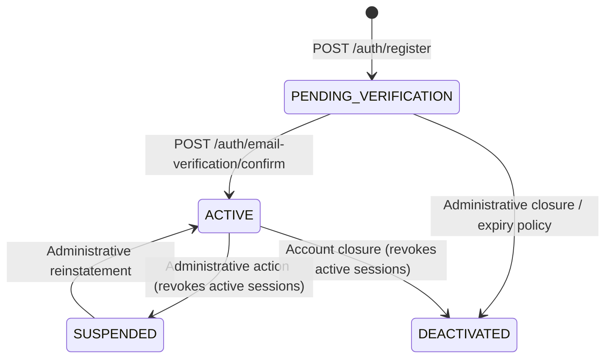
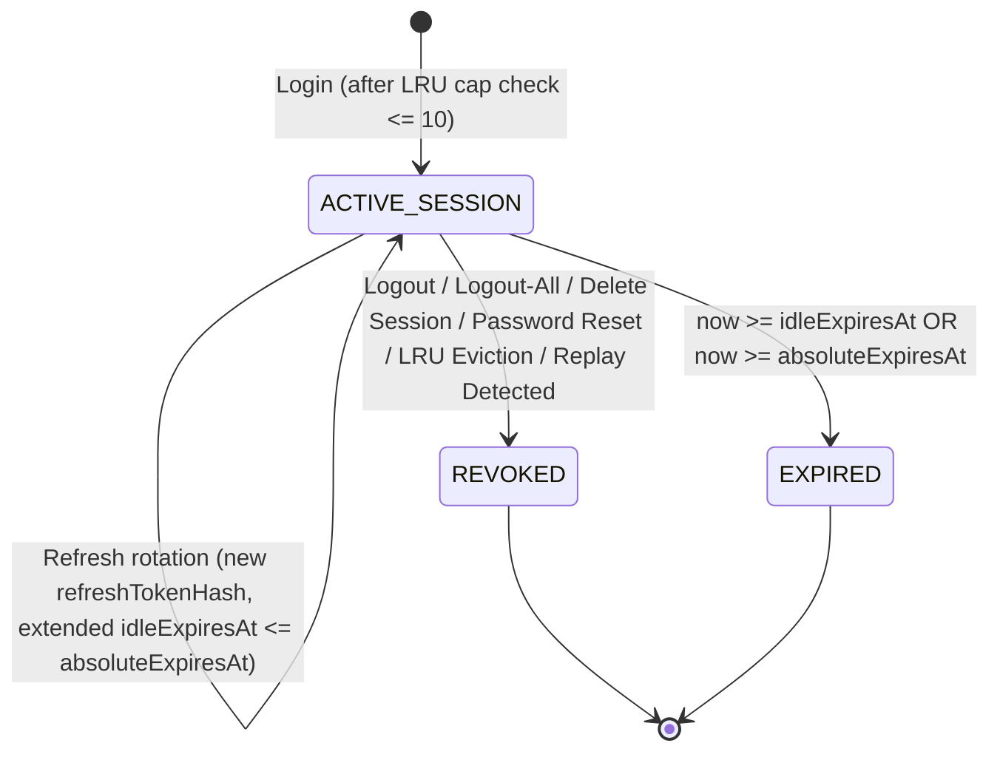
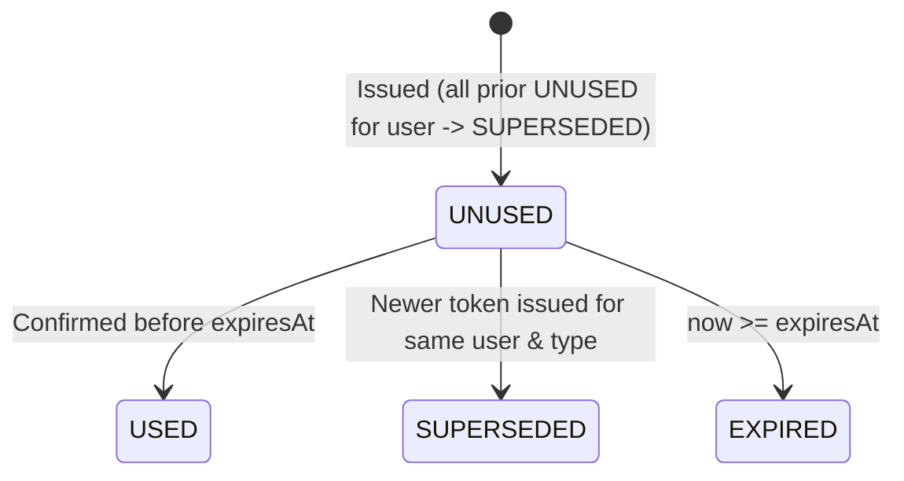

# Phase 1 Data Model: Authentication & Identity Management

**Feature**: `001-auth-identity-management`  
**Date**: 2026-11-26  
**ORM / Database**: Prisma ORM `7.10.1` (`prisma-client` generator) · Neon PostgreSQL  
**References**: [spec.md](./spec.md) · [research.md](./research.md) · [`docs/architecture/entity-catalog.md`](../../docs/architecture/entity-catalog.md) · [`docs/architecture/prisma-schema-design.md`](../../docs/architecture/prisma-schema-design.md)

---

## 1. Canonical Modeling Rules

1. **Primary Keys**: Non-sequential `UUID` v4 strings (`@id @default(uuid()) @db.Uuid`) across all entities, matching `ARC-DB-ENT-001` and `ARC-DB-PRI-001`.
2. **Timestamps**: All timestamps use PostgreSQL `TIMESTAMPTZ` (`@db.Timestamptz(6)`) persisted in UTC and serialized as ISO 8601 UTC strings. Append-only tables (`EmailVerificationToken`, `PasswordResetToken`, `AuditLog`) omit `@updatedAt`.
3. **Strict Tenant Decoupling (`FR-019`)**: `User` is a global human identity and carries **no** `organizationId` or role field. `AuditLog` includes a nullable `organizationId String? @db.Uuid` column (unconstrained FK until Phase 5.2 introduces `Organization`) so security events recorded in Phase 5.1 and tenant events recorded in Phase 5.2+ share one canonical `AuditLog` table without destructive schema rewrites.
4. **Prisma v7 Configuration**: Connection URLs remain exclusively in `server/prisma7.config.ts` (`DATABASE_URL_UNPOOLED` for CLI migrations) and `server/src/database/prisma.service.ts` (`DATABASE_URL` pooled via `@prisma/adapter-neon`), never inside `datasource db` in `server/prisma/schema.prisma`.

---

## 2. Enums

| Enum                  | Values                                                                                                                                   | Purpose                                                                    |
| --------------------- | ---------------------------------------------------------------------------------------------------------------------------------------- | -------------------------------------------------------------------------- |
| `UserStatus`          | `PENDING_VERIFICATION`, `ACTIVE`, `SUSPENDED`, `DEACTIVATED`                                                                             | Controls sign-in and session-renewal eligibility (`FR-006`).               |
| `SessionRevokeReason` | `USER_LOGOUT`, `USER_LOGOUT_ALL`, `USER_SESSION_REVOKE`, `PASSWORD_RESET`, `TOKEN_REUSE`, `MAX_SESSIONS_EVICTED`, `ACCOUNT_STATE_CHANGE` | Explains why an `AuthSession` ended for diagnostics and audit correlation. |

---

## 3. Entities & Field Specifications

### 3.1 `User` (`users`)

Global human account identity (`FR-001`–`FR-006`, `FR-011`, `FR-019`).

| Field             | Prisma / SQL Type           | Nullability | Constraints & Defaults           | Validation / Invariants                                                                 |
| ----------------- | --------------------------- | ----------- | -------------------------------- | --------------------------------------------------------------------------------------- |
| `id`              | `String` (`UUID`)           | Required    | `@id @default(uuid()) @db.Uuid`  | Immutable primary key.                                                                  |
| `email`           | `String` (`VARCHAR(254)`)   | Required    | Trimmed display email            | Valid RFC 5322 / HTML5 email, `<= 254` chars.                                           |
| `normalizedEmail` | `String` (`VARCHAR(254)`)   | Required    | `@unique`                        | `email.trim().toLowerCase()`; canonical lookup & uniqueness key (`FR-002`).             |
| `displayName`     | `String` (`VARCHAR(120)`)   | Required    | —                                | Trimmed `2..120` visible chars.                                                         |
| `passwordHash`    | `String` (`TEXT`)           | Required    | —                                | Argon2id PHC string (`$argon2id$v=19$...`); never selected into public DTOs (`FR-003`). |
| `status`          | `UserStatus`                | Required    | `@default(PENDING_VERIFICATION)` | Only `ACTIVE` users may establish or renew sessions (`FR-006`).                         |
| `emailVerifiedAt` | `DateTime?` (`TIMESTAMPTZ`) | Nullable    | —                                | Populated atomically when `EmailVerificationToken` is confirmed (`FR-014`).             |
| `createdAt`       | `DateTime` (`TIMESTAMPTZ`)  | Required    | `@default(now())`                | UTC creation instant.                                                                   |
| `updatedAt`       | `DateTime` (`TIMESTAMPTZ`)  | Required    | `@updatedAt`                     | UTC modification instant.                                                               |

**Indexes**:

- `@unique` on `normalizedEmail`
- `@@index([status, createdAt])`

---

### 3.2 `AuthSession` (`auth_sessions`)

Represents one browser/device authentication session and its active refresh-token verifier (`FR-008`–`FR-013`).

| Field               | Prisma / SQL Type           | Nullability | Constraints & Defaults                       | Validation / Invariants                                                             |
| ------------------- | --------------------------- | ----------- | -------------------------------------------- | ----------------------------------------------------------------------------------- |
| `id`                | `String` (`UUID`)           | Required    | `@id @default(uuid()) @db.Uuid`              | Embedded as prefix in `<sessionId>.<secret>` cookie for `O(1)` lookup.              |
| `userId`            | `String` (`UUID`)           | Required    | FK → `User.id` (`onDelete: Cascade`)         | Owning global user.                                                                 |
| `refreshTokenHash`  | `String` (`CHAR(64)`)       | Required    | `@unique`                                    | Hex `SHA-256` digest of current 256-bit refresh secret (`FR-008`).                  |
| `userAgent`         | `String?` (`VARCHAR(512)`)  | Nullable    | Truncated safely to 512 chars                | Sanitized client descriptor shown in `GET /auth/sessions` (`FR-013`).               |
| `ipHash`            | `String?` (`CHAR(64)`)      | Nullable    | Privacy-preserving `HMAC-SHA256` / `SHA-256` | Optional coarse anomaly context; never raw secret.                                  |
| `lastUsedAt`        | `DateTime` (`TIMESTAMPTZ`)  | Required    | `@default(now())`                            | Updated on login and each successful refresh; drives LRU eviction order (`FR-013`). |
| `idleExpiresAt`     | `DateTime` (`TIMESTAMPTZ`)  | Required    | `min(now + idleTtl, absoluteExpiresAt)`      | Sliding 14-day inactivity cutoff (`FR-008`, Clarification Q2).                      |
| `absoluteExpiresAt` | `DateTime` (`TIMESTAMPTZ`)  | Required    | `createdAt + absoluteTtl`                    | Hard 30-day maximum lifetime from initial sign-in (`FR-008`, Clarification Q2).     |
| `revokedAt`         | `DateTime?` (`TIMESTAMPTZ`) | Nullable    | —                                            | Non-null immediately invalidates session (`FR-009`, `FR-012`).                      |
| `revokedReason`     | `SessionRevokeReason?`      | Nullable    | —                                            | Populated whenever `revokedAt` is set.                                              |
| `createdAt`         | `DateTime` (`TIMESTAMPTZ`)  | Required    | `@default(now())`                            | Initial sign-in instant.                                                            |
| `updatedAt`         | `DateTime` (`TIMESTAMPTZ`)  | Required    | `@updatedAt`                                 | Last rotation/revocation instant.                                                   |

**Indexes**:

- `@unique` on `refreshTokenHash`
- `@@index([userId, revokedAt, idleExpiresAt])` (active-session list & 10-session cap query)
- `@@index([userId, lastUsedAt])` (LRU eviction ordering)

---

### 3.3 `EmailVerificationToken` (`email_verification_tokens`)

Single-use, expiring email ownership verification credential (`FR-014`, Clarification Q4).

| Field           | Prisma / SQL Type           | Nullability | Constraints & Defaults               | Validation / Invariants                                                                 |
| --------------- | --------------------------- | ----------- | ------------------------------------ | --------------------------------------------------------------------------------------- |
| `id`            | `String` (`UUID`)           | Required    | `@id @default(uuid()) @db.Uuid`      | Primary key.                                                                            |
| `userId`        | `String` (`UUID`)           | Required    | FK → `User.id` (`onDelete: Cascade`) | Target user account.                                                                    |
| `tokenHash`     | `String` (`CHAR(64)`)       | Required    | `@unique`                            | Hex `SHA-256` of 256-bit single-use token.                                              |
| `expiresAt`     | `DateTime` (`TIMESTAMPTZ`)  | Required    | `createdAt + 24h` (configurable)     | Expired tokens are rejected.                                                            |
| `usedAt`        | `DateTime?` (`TIMESTAMPTZ`) | Nullable    | —                                    | Set atomically when confirmed.                                                          |
| `invalidatedAt` | `DateTime?` (`TIMESTAMPTZ`) | Nullable    | —                                    | Set on all prior unused rows when a new verification link is issued (Clarification Q4). |
| `createdAt`     | `DateTime` (`TIMESTAMPTZ`)  | Required    | `@default(now())`                    | Issuance timestamp.                                                                     |

**Indexes**:

- `@unique` on `tokenHash`
- `@@index([userId, usedAt, invalidatedAt, expiresAt])`

---

### 3.4 `PasswordResetToken` (`password_reset_tokens`)

Single-use, expiring password-recovery credential (`FR-016`, Clarification Q4).

| Field           | Prisma / SQL Type           | Nullability | Constraints & Defaults               | Validation / Invariants                                                          |
| --------------- | --------------------------- | ----------- | ------------------------------------ | -------------------------------------------------------------------------------- |
| `id`            | `String` (`UUID`)           | Required    | `@id @default(uuid()) @db.Uuid`      | Primary key.                                                                     |
| `userId`        | `String` (`UUID`)           | Required    | FK → `User.id` (`onDelete: Cascade`) | Target user account.                                                             |
| `tokenHash`     | `String` (`CHAR(64)`)       | Required    | `@unique`                            | Hex `SHA-256` of 256-bit single-use reset token.                                 |
| `expiresAt`     | `DateTime` (`TIMESTAMPTZ`)  | Required    | `createdAt + 60m` (configurable)     | Short validity window (`FR-016`).                                                |
| `usedAt`        | `DateTime?` (`TIMESTAMPTZ`) | Nullable    | —                                    | Set atomically alongside `User.passwordHash` update and mass session revocation. |
| `invalidatedAt` | `DateTime?` (`TIMESTAMPTZ`) | Nullable    | —                                    | Set on all prior unused rows when a new reset link is issued (Clarification Q4). |
| `createdAt`     | `DateTime` (`TIMESTAMPTZ`)  | Required    | `@default(now())`                    | Issuance timestamp.                                                              |

**Indexes**:

- `@unique` on `tokenHash`
- `@@index([userId, usedAt, invalidatedAt, expiresAt])`

---

### 3.5 `AuditLog` (`audit_logs`)

Append-only security and operational audit record aligned with `ARC-DB-ENT-001` §9 (`FR-018`, `NFR-SEC-006`).

| Field            | Prisma / SQL Type          | Nullability | Constraints & Defaults                                      | Validation / Invariants                                                                                                                                                                                                                                                                                                                                              |
| ---------------- | -------------------------- | ----------- | ----------------------------------------------------------- | -------------------------------------------------------------------------------------------------------------------------------------------------------------------------------------------------------------------------------------------------------------------------------------------------------------------------------------------------------------------- |
| `id`             | `String` (`UUID`)          | Required    | `@id @default(uuid()) @db.Uuid`                             | Primary key.                                                                                                                                                                                                                                                                                                                                                         |
| `organizationId` | `String?` (`UUID`)         | Nullable    | Indexed; always `null` for global Phase 5.1 identity events | Ready for Phase 5.2 `Organization` FK attachment.                                                                                                                                                                                                                                                                                                                    |
| `actorUserId`    | `String?` (`UUID`)         | Nullable    | FK → `User.id` (`onDelete: SetNull`)                        | `null` for unauthenticated/unknown-actor failures.                                                                                                                                                                                                                                                                                                                   |
| `action`         | `String` (`VARCHAR(80)`)   | Required    | `UPPER_SNAKE_CASE` action code                              | e.g., `AUTH_REGISTER_SUCCESS`, `AUTH_LOGIN_SUCCESS`, `AUTH_LOGIN_FAILED`, `AUTH_SESSION_REFRESHED`, `AUTH_SESSION_REVOKED`, `AUTH_SESSION_LOGOUT_ALL`, `AUTH_SESSION_EVICTED`, `AUTH_SESSION_REUSE_DETECTED`, `AUTH_EMAIL_VERIFIED`, `AUTH_EMAIL_VERIFICATION_RESENT`, `AUTH_PASSWORD_RESET_REQUESTED`, `AUTH_PASSWORD_RESET_COMPLETED`, `AUTH_USER_STATUS_CHANGED`. |
| `entityType`     | `String` (`VARCHAR(60)`)   | Required    | —                                                           | e.g., `User`, `AuthSession`, `EmailVerificationToken`, `PasswordResetToken`.                                                                                                                                                                                                                                                                                         |
| `entityId`       | `String?` (`VARCHAR(128)`) | Nullable    | —                                                           | Target UUID when known; `null` on unknown-email attempts.                                                                                                                                                                                                                                                                                                            |
| `requestId`      | `String?` (`VARCHAR(128)`) | Nullable    | Propagated from `RequestContext`                            | Links audit entry to structured HTTP logs (`NFR-OBS-002`).                                                                                                                                                                                                                                                                                                           |
| `correlationId`  | `String?` (`VARCHAR(128)`) | Nullable    | Propagated from `RequestContext`                            | Cross-boundary trace correlation (`SC-007`).                                                                                                                                                                                                                                                                                                                         |
| `metadata`       | `Json?` (`JSONB`)          | Nullable    | Sanitized allowlisted keys only                             | Outcome/reason codes only; **never** passwords, raw emails on unknown-account probes, tokens, hashes, or cookies (`FR-018`).                                                                                                                                                                                                                                         |
| `occurredAt`     | `DateTime` (`TIMESTAMPTZ`) | Required    | `@default(now())`                                           | Event timestamp; append-only (no `update`/`delete` exposed in `AuditLogsService`).                                                                                                                                                                                                                                                                                   |

**Indexes**:

- `@@index([actorUserId, occurredAt])`
- `@@index([organizationId, occurredAt])`
- `@@index([action, occurredAt])`
- `@@index([correlationId])`

---

## 4. State Transitions

### 4.1 `User.status` Lifecycle



- **Invariant**: Sign-in (`POST /auth/login`), session renewal (`POST /auth/refresh`), and `AccessTokenGuard` session checks require `User.status === 'ACTIVE'`.

### 4.2 `AuthSession` Lifecycle



### 4.3 Single-Use Verification & Reset Credentials



---

## 5. Prisma v7 Schema Target (`server/prisma/schema.prisma`)

```prisma
generator client {
  provider = "prisma-client"
  output   = "../src/generated/prisma"
}

datasource db {
  provider = "postgresql"
}

enum UserStatus {
  PENDING_VERIFICATION
  ACTIVE
  SUSPENDED
  DEACTIVATED
}

enum SessionRevokeReason {
  USER_LOGOUT
  USER_LOGOUT_ALL
  USER_SESSION_REVOKE
  PASSWORD_RESET
  TOKEN_REUSE
  MAX_SESSIONS_EVICTED
  ACCOUNT_STATE_CHANGE
}

model User {
  id              String     @id @default(uuid()) @db.Uuid
  email           String     @db.VarChar(254)
  normalizedEmail String     @unique @db.VarChar(254)
  displayName     String     @db.VarChar(120)
  passwordHash    String
  status          UserStatus @default(PENDING_VERIFICATION)
  emailVerifiedAt DateTime?  @db.Timestamptz(6)
  createdAt       DateTime   @default(now()) @db.Timestamptz(6)
  updatedAt       DateTime   @updatedAt @db.Timestamptz(6)

  sessions           AuthSession[]
  emailVerifications EmailVerificationToken[]
  passwordResets     PasswordResetToken[]
  auditLogs          AuditLog[]               @relation("AuditActor")

  @@index([status, createdAt])
  @@map("users")
}

model AuthSession {
  id                String               @id @default(uuid()) @db.Uuid
  userId            String               @db.Uuid
  refreshTokenHash  String               @unique @db.Char(64)
  userAgent         String?              @db.VarChar(512)
  ipHash            String?              @db.Char(64)
  lastUsedAt        DateTime             @default(now()) @db.Timestamptz(6)
  idleExpiresAt     DateTime             @db.Timestamptz(6)
  absoluteExpiresAt DateTime             @db.Timestamptz(6)
  revokedAt         DateTime?            @db.Timestamptz(6)
  revokedReason     SessionRevokeReason?
  createdAt         DateTime             @default(now()) @db.Timestamptz(6)
  updatedAt         DateTime             @updatedAt @db.Timestamptz(6)

  user User @relation(fields: [userId], references: [id], onDelete: Cascade)

  @@index([userId, revokedAt, idleExpiresAt])
  @@index([userId, lastUsedAt])
  @@map("auth_sessions")
}

model EmailVerificationToken {
  id            String    @id @default(uuid()) @db.Uuid
  userId        String    @db.Uuid
  tokenHash     String    @unique @db.Char(64)
  expiresAt     DateTime  @db.Timestamptz(6)
  usedAt        DateTime? @db.Timestamptz(6)
  invalidatedAt DateTime? @db.Timestamptz(6)
  createdAt     DateTime  @default(now()) @db.Timestamptz(6)

  user User @relation(fields: [userId], references: [id], onDelete: Cascade)

  @@index([userId, usedAt, invalidatedAt, expiresAt])
  @@map("email_verification_tokens")
}

model PasswordResetToken {
  id            String    @id @default(uuid()) @db.Uuid
  userId        String    @db.Uuid
  tokenHash     String    @unique @db.Char(64)
  expiresAt     DateTime  @db.Timestamptz(6)
  usedAt        DateTime? @db.Timestamptz(6)
  invalidatedAt DateTime? @db.Timestamptz(6)
  createdAt     DateTime  @default(now()) @db.Timestamptz(6)

  user User @relation(fields: [userId], references: [id], onDelete: Cascade)

  @@index([userId, usedAt, invalidatedAt, expiresAt])
  @@map("password_reset_tokens")
}

model AuditLog {
  id             String   @id @default(uuid()) @db.Uuid
  organizationId String?  @db.Uuid
  actorUserId    String?  @db.Uuid
  action         String   @db.VarChar(80)
  entityType     String   @db.VarChar(60)
  entityId       String?  @db.VarChar(128)
  requestId      String?  @db.VarChar(128)
  correlationId  String?  @db.VarChar(128)
  metadata       Json?
  occurredAt     DateTime @default(now()) @db.Timestamptz(6)

  actorUser User? @relation("AuditActor", fields: [actorUserId], references: [id], onDelete: SetNull)

  @@index([actorUserId, occurredAt])
  @@index([organizationId, occurredAt])
  @@index([action, occurredAt])
  @@index([correlationId])
  @@map("audit_logs")
}
```
